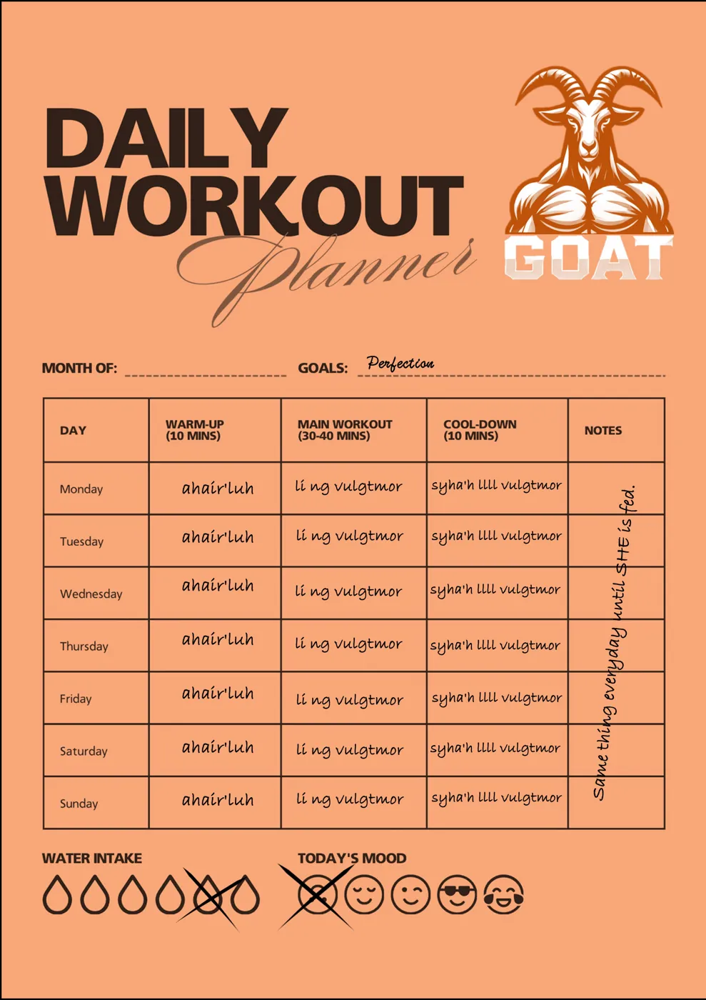

> **Раздатка 4. Ежедневник тренировок**
>
> ЕЖЕДНЕВНИК ТРЕНИРОВОК — GOAT  
> МЕСЯЦ: ________  ЦЕЛИ: Совершенство  
> ДЕНЬ | РАЗМИНКА (10 МИН) | ОСНОВНАЯ ТРЕНИРОВКА (30–40 МИН) | ЗАМИНКА (10 МИН) | ЗАМЕТКИ  
> Понедельник — воскресенье (каждый день одно и то же): ahair'luh | li ng vulgtmor | syha'h llll vulgtmor  
> Заметки (поперёк столбца): Одно и то же каждый день, пока ОНА не насытится.  
> ПОТРЕБЛЕНИЕ ВОДЫ: шесть капель, пятая зачёркнута. НАСТРОЕНИЕ ДНЯ: зачёркнут первый смайлик.  
