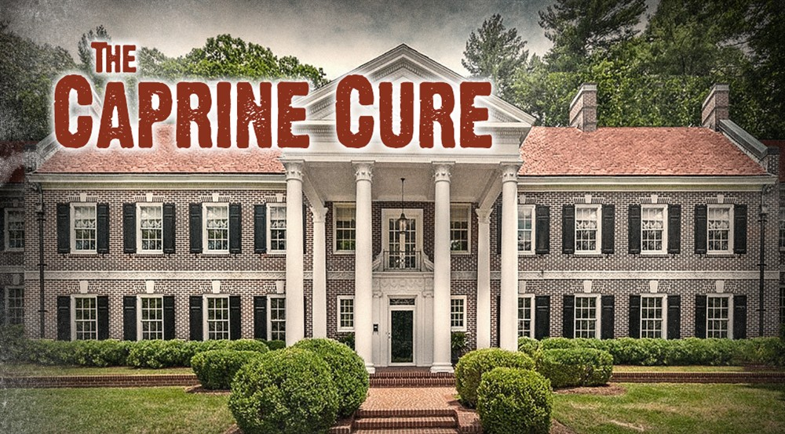

# Козье снадобье

*Сценарий Колина Ричардса для «Зова Ктулху» в наши дни*  
*Сыщиков: 1–5 • Время игры: 4 часа*

## Введение

На курорте «Кэприн-Спрингс», в уединённом лесном спа-центре среди холмов Западной Виргинии, готовится особая оздоровительная программа «Козье снадобье». Попасть на неё можно только по приглашению. Для участия в «лечении» отобрали нескольких знаменитостей и представителей высшего общества. Каждый из них соберёт ингредиенты для собственного целебного эликсира, а заодно осмотрит курорт и испробует всё, что тот предлагает гостям. Но не всё здесь так, как кажется. Сама природа растёт и движется самым причудливым образом, а сыщиков искушают покориться культу «Матери». Влияние Шуб-Ниггурат над ними крепнет, и сыщикам придётся оглянуться на свою жизнь и решить, принять Козье снадобье или отвергнуть его.

### Структура сценария

Действие занимает три дня и целиком разворачивается на курорте «Кэприн-Спрингс». Каждый день сыщики отправляются в новую часть курорта: занимаются йогой, медитируют, ходят на массаж и так далее. В каждом месте каждый сыщик должен собрать ингредиент для своего «снадобья». Заодно сыщики находят улики, которые помогают понять, что это за ингредиенты и какую тайну скрывает курорт.

Наконец, на третий день сыщики получают возможность испробовать смесь из выбранных ими ингредиентов. Дальнейшее зависит от состава и от их поступков. Сыщики могут преобразиться, стать добычей на охоте или испытать нечто похуже.

Чтобы уложить игру в четыре часа, отведите по часу на каждый из трёх дней и ещё полчаса на финал. Оставшееся время можно разделить между вступлением и началом сценария (20 минут) и подведением итогов (10 минут).

## Предыстория

Курорт «Кэприн-Спрингс» основали в 1756 году в самом сердце Аппалачей, на юге будущего штата Западная Виргиния. Имя источнику дали стада чёрных коз, бродивших по окрестным холмам и ложбинам. Говорили, что его вода исцеляет и способна изменить жизнь. С годами курорт без лишнего шума набирал известность и в конце концов снискал славу места, где можно исцелить тело, отточить ум и вырасти духовно.
