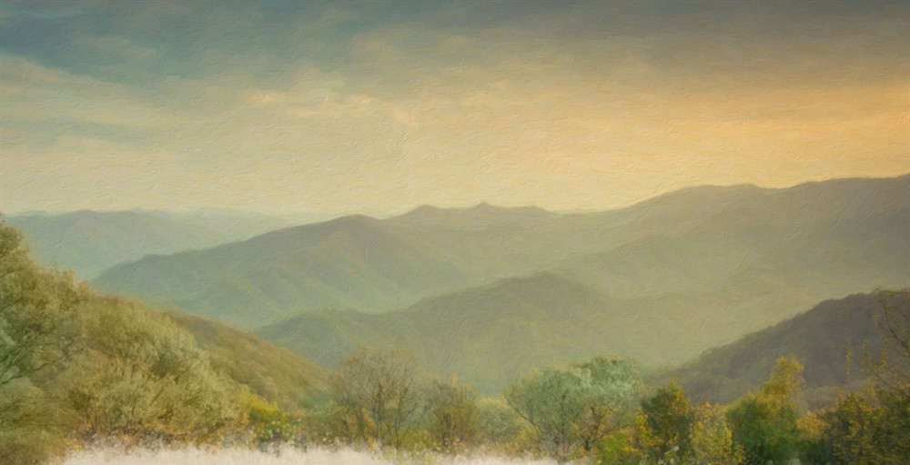

## О сыщиках

Все сыщики — люди влиятельные, принадлежащие к верхушке общества. И у каждого есть серьёзные изъяны. Все приняли приглашение на курорт, чтобы испробовать «снадобье». Предложите игрокам придумать биографии своих персонажей на основе приведённых ниже типажей или просто взять их за отправную точку.

### Блогер-инфлюенсер

Обзоры спа-салонов, гармония души и тела, еда прямо с фермы и прочие поветрия здорового образа жизни кормят блогера. Его публикации напоминают зрителям, чего им не хватает, и гонят их от одной модной диеты и программы тренировок к другой. А сам блогер измеряет свою ценность числом подписчиков и лайков под каждой публикацией. Так он и его поклонники живут друг за счёт друга.

### Телекомментатор

Телекомментатор в ярости и хочет, чтобы вы тоже взбесились! Из-за чего именно — меняется каждую неделю. Возмущение отлично продаётся, и дела сейчас идут в гору. Пока мир горит, а зрителей подталкивают к насилию, телекомментатор с ухмылкой подсчитывает прибыль.

### Дилетант

Дилетант мечтает никогда не пошевелить и пальцем. Для этого других нанимают. Труд — удел людей попроще. Дилетант пользуется внешностью и фамилией, чтобы его баловали, возили и обслуживали, и не замечает, по чьим головам при этом идёт.

### Модель

У модели есть всё: эффектная внешность, выгодные контракты, приглашения на лучшие вечеринки. Но ничто не вечно, и с возрастом всё нажитое ускользает. Всегда найдётся кто-нибудь новее, моложе и красивее. Модель пойдёт на что угодно, лишь бы удержать своё место, пусть и за чужой счёт.

### Магнат

Самая модная одежда, самые крутые машины, самые редкие деликатесы и самые закрытые клубы — магнату нужно только лучшее. С его состоянием он может себе это позволить, а значит, по его мнению, имеет на это право. У кого меньше — пусть учится всего добиваться сам.

> **Телефоны, камеры и свита**
>
> Сыщики с таким положением могут попросить привезти слуг или свиту, а также телефоны и камеры, чтобы вести прямые трансляции с курорта. Однако в «Кэприн-Спрингс» строгое правило: никаких телефонов, камер и личного персонала. До приезда каждый сыщик согласился с этим условием договора.
>
> Если Хранитель не хочет настаивать на запрете, пусть использует технику и сопровождающих, чтобы усилить драму и страх. Друзья или слуги сыщика могут оказаться тайными членами культа Матери. Электроника может сойти с ума или показать ужасные видения грядущего. Курорт достаточно удалён, чтобы здесь не было сотовой связи; Wi-Fi на время программы отключён.
