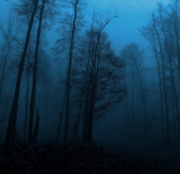

## Начало сценария

Сценарий начинается вечером, когда сыщики приезжают на курорт «Кэприн-Спрингс». Он находится в нескольких километрах от ближайшего города, высоко в Аппалачах, куда ведут извилистые дороги. Сейчас середина марта текущего года. Выдайте игрокам раздатку 1 «Карта курорта „Кэприн-Спрингс“».

По дороге в горы видны только голые деревья и пустые поля. Но стоит проехать тоннель и выехать на территорию курорта, как оказывается, что в окружающем лесу уже набухли почки, словно весна пришла необычно рано. Владения курорта обширны: здесь есть Главный корпус, Спа, Ферма и винокурня, хозяйственные постройки и многие километры троп.

Сыщики прибывают к Главному корпусу — огромному четырёхэтажному викторианскому зданию с белыми стенами и тёмно-красными остроконечными крышами. Каменные ступени ведут на просторную веранду, огибающую первый этаж; ряд двустворчатых дверей выходит в вестибюль. От центральной части по обеим сторонам тянутся два крыла. Здание богато отделано, но так удачно вписано в пейзаж, что от него веет покоем.

Сотрудники в тёмно-красной форме встречают сыщиков, паркуют машины и забирают багаж. Гостей проводят через роскошно обставленный корпус в зал с панорамными окнами, где их ждут изысканные закуски и коктейли. Молодая женщина в тёмно-красном поло, Ньяла Ндила, просит внимания.

Прочтите или перескажите:

> Добрый вечер, дорогие гости! Добро пожаловать в «Кэприн-Спрингс». Поздравляю: именно вас выбрали для «Козьего снадобья» в этом году.
>
> Меня зовут Ньяла Ндила. Пока вы у нас, я буду вести вашу программу.
>
> Уже больше 250 лет «Кэприн-Спрингс» помогает людям жить полной жизнью и быть собой. Наша программа — плод векового опыта. В ней соединились наука, природа и духовная практика.
>
> Раз уж нам предстоит провести несколько дней вместе, представьтесь, пожалуйста, и ответьте на один вопрос: что бы вы изменили в себе, если бы могли? Чем больше вы вложите в эту программу, тем больше она вам даст. Мы просим вас быть совершенно откровенными с нами, друг с другом и прежде всего с самими собой.

Каждый сыщик представляется остальным и отвечает на вопрос. Затем Ндила продолжает:

> Прекрасно! В ближайшие три дня вас ждут разные оздоровительные занятия: в Спа, на Ферме и винокурне и в Дендрарии. В каждом месте выберите ингредиент, который, по-вашему, лучше всего выражает ту перемену, какой вы хотите для себя. Принесите всё на гала-вечер на третий день, и вы приготовите своё собственное снадобье. Мы устроим большой праздник в честь ваших успехов и выпьем за ваше здоровье!
>
> А теперь угощайтесь и знакомьтесь. За вас — и за тех, кем вы станете!

Остаток вечера сыщики вольны провести как захотят, при тусклом свете тонкого серпа убывающей луны.

## Ночные сны

С первой же ночи сыщикам снятся странные сны. Во всех есть природа, покой и ощущение, что они наконец среди своих. Например:

- Бежать по древнему лесу сперва на двух ногах, потом на четырёх.
- Видеть, как прекрасные растения разрастаются и укрывают весь мир, все здания и всех людей.
- Уходить под землю — сначала в ужасе, потом в тепле, покое и безопасности.
- Встретить десятки рогатых фигур на козьих ногах, которые принимают сыщика как родного.

Несмотря на странные сны, сыщики просыпаются отдохнувшими и полными сил.
