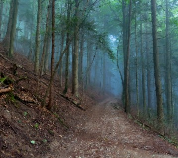

## Места

Каждый день после завтрака сыщики вместе решают, куда сегодня пойти: в Спа, в Дендрарий или на Ферму. Если договориться не удаётся, решает Ндила. После дневных занятий сыщики возвращаются в Главный корпус на ужин, а вечер у них свободен. Можно осмотреть корпус, тайком вернуться в уже посещённые места или заняться поиском сведений.

### Территория курорта

Вокруг курорта раскинулся обширный холмистый лес, весь в тропах и геотермальных прудах. Источник, с которого всё началось, бьёт на вершине высокого холма. Вода сбегает широким ручьём и образует водопад в Дендрарии. Прямо над источником, на вершине холма, стоит Старая купальня. До гала-вечера сыщики найдут её крепко запертой.

Места тут живописные и тихие, но стоит отойти от курорта, как слышатся странные звуки, а среди деревьев мелькают силуэты. Это бывшие гости и культисты, превращённые в страшных зверей-охотников и ходячие деревья. Они охраняют курорт и никому не дают сбежать.

### Главный корпус

Это обширное викторианское здание возвели в 1850-х годах взамен нескольких небольших домиков для гостей. С тех пор к нему пристроили крылья с административными кабинетами, гостевыми номерами и другими помещениями.

Курорт якобы закрыт на ремонт, однако ремонтников нигде не видно. На месте лишь Ндила и горстка помощников и служителей. Когда сыщик остаётся один, в коридорах и на территории стоит жуткая тишина.

Осматривая Главный корпус по вечерам, сыщики могут найти следующее:

- На стенах висят фотографии в рамках: знаменитости, политики и промышленные магнаты прошлого и настоящего отдыхают на курорте. Успешная проверка Внимания позволяет заметить на нескольких снимках расплывчатую козлоголовую фигуру на заднем плане. Это требует проверки Рассудка (потеря 0/1). Если спросить сотрудников, те спишут всё на игру света или обман зрения.
- Раздатка 2 — табличка «Великая Мать». Надпись о Великой Матери подсказывает, что три ингредиента Роста — **лаванда**, **козье молоко** и **яблоко**. Под табличкой стоит горшок с лавандой.
- В вестибюле лежит большой подарочный альбом об истории курорта с 1756 года до наших дней. При успешной проверке Родного языка сыщик узнаёт, что минеральный источник, питающий купальни, бьёт из системы пещер, где есть странные петроглифы с козлоголовыми фигурами и другими сценами поклонения природе.
- В нишах расставлены крупные камни необычного чёрного цвета, странно тёплые на ощупь. Если присмотреться, очертания начинают напоминать человеческие, словно это окаменевшие в таких позах тела. Тревожная догадка требует проверки Рассудка (потеря 0/1).
- По полу тянутся мокрые следы копыт к двери с надписью «Только для персонала». Дверь заперта; открыть её можно успешной проверкой Взлома или трудной проверкой СИЛ. Внутри странное святилище: небольшая каменная фигурка беременной женщины с козьими рогами, глазами и раздвоенными копытами, вокруг — ветки лаванды, яблоки, мёд, соль и кувшины молока. Рядом записка: *«Венец — хранить сильных, шар — прозревать мудрым, копыта — идти тайной тропой; когда трое станут одним, ты пронзишь зелёный покров».*

### Спа

Одноэтажное здание со вкусом отделано местным камнем и деревом. Коридоры ведут на несколько подземных уровней с массажными кабинетами без окон и небольшими комнатами отдыха. Все помещения оформлены как пещеры, с мягким светом и спокойной музыкой из скрытых динамиков. Здесь царит тишина и покой.
