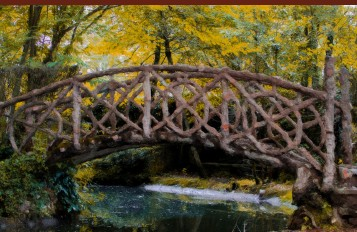

Когда хотя бы двое сыщиков добыли по ингредиенту, все разом приходят в себя в Парной. Каждый держит то, что успел найти. Ндила пришла проводить гостей на следующую процедуру. Расспросив их о пережитом, она объясняет, что в Парной бывают видения и сны, и советует считать это добрым знаком.

Пергамент со стишками исчез, но вечером один из сыщиков обнаружит его в своей подарочной корзине.

### Завершение спа-процедур и выбор подарочной корзины

В завершение визита сыщикам предлагают одну из трёх процедур с натуральными ингредиентами, произведёнными на курорте. Каждая повышает одну характеристику и приносит ингредиент: он ждёт сыщика в подарочной корзине в номере. Кто уже нашёл ингредиент, может оставить оба, а на гала-вечере решить, какой использовать.

*Прим. перев.: в оригинале сказано «из трёх процедур», но в списке их четыре.*

На выбор предлагаются следующие процедуры и ингредиенты:

- **Геотермальная лавандовая ванна «Благословение природы» (G)**: +5 к МОЩ; в подарочной корзине — лавандовые эфирные масла, косметика, печенье и чай.
- **Преображающее шоколадное обёртывание «Больше чем красота» (T)**: +5 к СИЛ; в корзине — шоколадные конфеты, какао-порошок, шоколадные скрабы для лица и лосьоны.
- **Мистический метаморфический кофейный скраб для всего тела (T)**: +5 к ЛВК; в корзине — кофе в зёрнах и молотый, кофейное печенье и конфеты, мыло и масла с ароматом кофе.
- **Вечный массаж горячими соляными камнями (S)**: +5 к ВЫН; в корзине — разные соли, пряные натирки, масла, скрабы для тела и очищающие средства.

### Дендрарий

Красивые каменные дорожки вьются среди деревьев и цветов на нескольких гектарах. Через ручей перекинуто несколько простых деревянных мостиков. Тут и там виднеются небольшие геотермальные пруды. Хотя зима ещё не кончилась, на многих деревьях уже набухли почки, а цветы распустились вовсю.

В день посещения Дендрария Ндила встречает сыщиков и предлагает им осмотреться, размышляя о своём месте в природе:

> Перед вами живое святилище. Корни и листья шепчут древнейшие истины, а цветы тянутся к свету, как дети к матери. Путь долог, но важнее всего то, чему вы на нём научитесь.

Здесь четыре тропы с указателями: Фруктовая тропа, Грибная тропа, Цветочная аллея и Тихий ручей. Ндила объясняет, что все четыре ведут к Пруду у водопада, где пройдёт медитация.

### Прогулки на природе

Указатели ясно показывают, как пройти к водопаду, на курорт и к другим примечательным местам. Вдоль каждой тропы стоят таблички об истории и применении того, что растёт или встречается поблизости. По пути сыщики могут собирать ингредиенты.

На Фруктовой тропе, среди деревьев, только начинающих плодоносить, стоит табличка № 1: «У множества народов плоды означают изобилие, наслаждение и знание. Яблоки особенно ценят как дар жизненной силы: они укрепляют тело и разум». **Яблоки (G)** можно сорвать с веток над головой.

На Грибной тропе среди дикорастущих грибов стоит табличка № 2: «У грибов множество причудливых форм и размеров. Часто они растут в тени, там, где всё разлагается, и напоминают о способности природы всё преображать». Здесь можно собрать **грибы (T)** самых разных форм и размеров.
