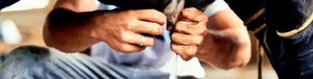
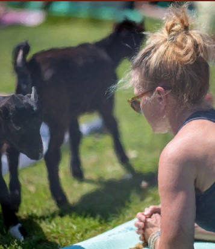

### С фермы на стол

После экскурсии каждый сыщик может выбрать одно занятие: доение коз, дегустацию виски, резьбу по тыкве или сбор мёда. Каждое повышает одну характеристику и даёт ингредиент, который будет ждать сыщика в подарочной корзине в номере.

#### Доение коз

**(G)**: +5 к МОЩ; в корзине — сыры, йогурты, лосьоны и мыло из **козьего молока**. Учиться доить чёрных коз приятно: рядом с ними на душе становится спокойно. Однако через несколько минут сыщики замечают, что у некоторых коз глаза будто человеческие. Это требует проверки Рассудка (потеря 0/1). На вопросы работники отвечают, что у коз, которых поколениями разводят на фермах, бывают странные мутации. Успешная проверка Естествознания подтверждает, что мутации возможны, но человеческие глаза — едва ли.

#### Дегустация виски

**(S)**: +5 к ВЫН; в корзине — выдержанный **виски**. Работники проводят дегустацию. Выдержанные напитки божественны на вкус и поднимают дух.

#### Резьба по тыкве

**(S)**: +5 к СИЛ; в корзине — пюре из **тыквы**, печенье, конфеты, кремы для лица и очищающие средства. Сыщики берут зазубренные ножи и надрезают жёсткую кожуру. Успешная проверка СИЛ позволяет снять большой кусок кожуры. Под ним красные волокнистые потроха, на миг похожие на человеческие внутренности. Это требует проверки Рассудка (потеря 0/1).

#### Сбор мёда

**(T)**: +5 к ЛВК; в корзине — сырой **мёд**, медовые конфеты, кремы и скрабы. Сыщики идут за служителями, открывают улей и вынимают соты. Работники объясняют, что пчёлы смирные: если не делать резких движений, они не укусят и не ужалят. Успешная проверка Ловкости рук позволяет действовать достаточно аккуратно, чтобы не всполошить пчёл и не бежать от ульев под градом болезненных укусов. Тем, кто остаётся, гудение кажется приятным. Но вскоре оно переходит в шёпот: «Сладость изменит облик твой. Возрадуйся». Услышавшие голос проходят проверку Рассудка (потеря 0/1).

### Йога с козлятами

После выбранного занятия сыщикам предлагают сеанс йоги с козлятами. Кто не захочет участвовать, может посмотреть из-за ограды. Пока сыщики тянутся и меняют позы, козлята блеют и шутливо запрыгивают на них. Один козлёнок с человеческими глазами скачет и пританцовывает, стараясь поймать взгляд одного или нескольких сыщиков. Успешная проверка Психологии даёт понять, что козлёнок хочет им что-то показать. Тех, кто пойдёт за ним, он уведёт от группы за амбар к огромной груде костей и плоти, над которой гудят большие чёрные пчёлы. При провале проверки ВЫН сыщика рвёт от ужасной вони. Козлёнок скребёт кучу копытом, показывая, что оттуда надо что-то достать.

Осмелившийся сунуть руку вытаскивает странную тёмно-красную семенную коробочку величиной с теннисный мяч; две её половинки похожи на раздвоенное козье копыто. Это **копытосемя**, ингредиент (G*). Доставая его, сыщик замечает, что часть костей и плоти — человеческие. Это требует проверки Рассудка (потеря 1/1d3).

Как только кто-то добудет ингредиент или все решат уйти от груды, сыщики внезапно приходят в себя на йоге с козлятами. Похоже, они задремали в расслабленной позе. За амбаром, где лежали кости, теперь только пустое поле. Копытосемя, однако, позже обнаружится в кармане того, кто его вытащил.
