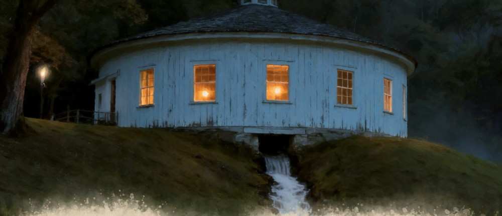

## Большой гала-вечер

После занятий третьего дня сыщиков отвозят в Главный корпус. Ндила встречает их и говорит, что гала-вечер начнётся сегодня поздно вечером. На закате надо прийти в вестибюль и принести все ингредиенты — и то, что было в подарочных корзинах, и то, что сыщики нашли на курорте. Окончательный выбор трёх ингредиентов они сделают на самом празднике. Пока есть несколько часов, чтобы отдохнуть, поговорить или осмотреться.

На закате в вестибюле ждут Ндила и несколько циген-служителей в козьих масках. С факелами в руках они ведут сыщиков сквозь тёмный лес к Старой купальне. Из чащи долетают скрип и стоны деревьев, козье блеяние и другие звериные крики. Тропа пересекает ручей, минует водопад и уходит вверх в холмы.

### Гала-вечер

Старая купальня — большое круглое одноэтажное здание из выкрашенного в белый цвет дерева на вершине высокого холма. Из-под здания бежит ручей, петляя по склону до самого водопада в Дендрарии. Последние несколько метров пути освещают факелы; изнутри мерцает свет керосиновых фонарей.

Деревянный пол окружает большой бассейн. Прямо над ним в крыше проём, в котором видны мерцающие звёзды и почти неразличимая в новолуние луна. Бассейн высечен в скале; он около 1,7 м глубиной и около 6,7 м в поперечнике. С двух сторон в воду спускаются деревянные ступени. Посередине, сквозь отверстие под решёткой, бурлит и пенится вода источника Кэприн.

Вокруг бассейна идёт настил шириной около 5 м. На нём стоят высокие столики, украшенные ветками, цветами и плодами. Посередине каждого — козий череп, испещрённый странными знаками и приспособленный под подсвечник; с него капает воск. Около тридцати человек в тяжёлых тёмно-красных с серебром одеяниях пьют из бокалов для шампанского, едят закуски и смотрят, как входят сыщики. Служители закрывают двери. Ндила предлагает немного пообщаться с гостями.

*Прим. перев.: «закуски» в оригинале напечатаны «hors d’vours» вместо «hors d’œuvres».*

### Знакомства и разговоры

Сыщики могут подойти к знаменитым гостям. Оглядев собравшихся, каждый узнает кого-нибудь: друга, коллегу, наставника или кумира, с которым ещё не доводилось встречаться. Это непременно человек успешный: предприниматель, политик, знаменитость. Если его спросить, он с воодушевлением признается, что именно благодаря его покровительству сыщик попал на «Козье снадобье».

Любой гость скажет, что сам принимал Козье снадобье и только ему обязан своим успехом. Успешная проверка Обаяния, Красноречия, Убеждения или Запугивания позволяет получить конкретный совет о выборе ингредиентов. Например:

> Хотите открыть свой разум всему, что даёт Мать? Возьмите **яблоко** (или другой ингредиент Роста).
>
> Хочется стать чем-то большим? Измениться… телом? Я бы выбрал **шоколад** (или другой ингредиент Превращения).
>
> Вы довольны собой? Ничего больше не нужно? Тогда берите **соль** (или другой ингредиент Застоя).
