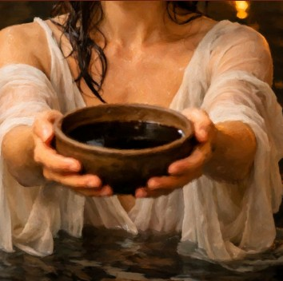

#### (Рост + Рост + Застой): Возлюбленный Земли

Прибавьте 30 к НАР. Сыщик становится красивее: исчезают пятна, шрамы и другие изъяны. Но внутри органы превращаются в грибы, а кости — в дерево. Сыщик предан Шуб-Ниггурат, однако может вернуться к людям и разносить пыльцу и споры. Годы спустя превращение завершится: останется смутно человекоподобное сплетение прекрасных цветов, грибных ножек и вьющихся лоз.

#### (Рост + Превращение + Превращение): Зверь охоты

Прибавьте по 30 к СИЛ, ЛВК и ВЫН и снизьте Рассудок до 0. Сыщик становится чудовищным зверем: грубая чёрная шерсть, козьи ноги, острые когти и клыки. Его выводят в лес и отпускают на волю. Теперь это бездумный, но хитрый хищник, который служит Шуб-Ниггурат каждым кровавым убийством.

#### (Рост + Превращение + Застой): Дитя Чёрной Козы

Сыщик сохраняет Рассудок, но становится чёрной козой с человеческими глазами. Его заставляют жить в стаде на Ферме и служить курорту.

#### (Рост + Застой + Застой): Слуга сломленного разума

Снизьте Рассудок сыщика до 0. Его представление о себе растворяется во всепоглощающей любви к культу. Ему выдают козью маску и позволяют стать циген-служителем. Он помогает гостям курорта, пребывая в блаженном неведении о собственной участи.

#### (Превращение + Превращение + Превращение): Плодовитые собратья

Сыщик сохраняет Рассудок, но беременеет, независимо от пола. Его приглашают в культ; со временем он, возможно, вернётся к людям — если переживёт рождение множества чудовищ, растущих у него внутри.

#### (Превращение + Превращение + Застой): Прекрасные

Снизьте МОЩ до 0, прибавьте 30 к ИНТ и 50 к НАР. Сыщик приобретает нечеловеческую красоту, но становится бездумным и безучастным. Лишившись собственной воли, он покорно служит культу, зазывая на курорт будущих посвящённых.

#### (Превращение + Застой + Застой): Дубовый страж

Плоть сыщика превращается в твёрдую кору, конечности и туловище растут и меняются. Служители торопливо выводят его из купальни: там он окончательно превратится в разумное дерево, способное передвигаться. Ему предстоит бродить по лесу и сторожить курорт.

#### (Застой + Застой + Застой): Живой камень

Снизьте ИНТ сыщика до 0. Он превращается в живое изваяние из чёрного камня, которому суждено вечно украшать курорт.

#### (3 × S*): Бесконечная мука

Снизьте СИЛ, ЛВК и Скорость до 0 и прибавьте 20 к ТЕЛ: сыщик распухает и превращается в огромную груду плоти. Его относят к ульям, где он служит падалью для пчёл-стервятников. К следующей кормёжке плоть неизменно отрастает. Сыщик всё это время в полном сознании, но не в силах управлять своим бессмертным телом.

## Заключение

После гала-вечера предложите игрокам рассказать, что стало с выжившими сыщиками после их личного «снадобья». Кто-то захочет показать, насколько лучше теперь живётся персонажу под покровительством Матери и её культа, а кто-то — с чем приходится мириться в новой жизни. В завершение Хранитель может описать, как обращённые сыщики выбирают, кому предложат Козье снадобье в следующий раз.
