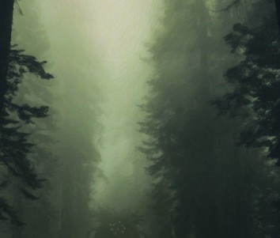

## Персонажи и чудовища

### Ньяла Ндила, 31 год

*Координатор программы и жрица культа*

```stat
СИЛ 50   ВЫН 55   ТЕЛ 40   ЛВК 60   ИНТ 70
НАР 65   МОЩ 80   ОБР 60   Рассудок 0   ПЗ 9
БкУ: 0   Комплекция: 0   Скорость: 8   ПМ: 16   Удача: —

Атак за раунд: 1 (драка).
Ближний бой (драка) 40% (20/8), урон 1d3+БкУ.
Уклонение 30% (15/6).

Навыки: Обаяние 70%, Мифы Ктулху 35%, Первая помощь 40%, Естествознание 70%, Оккультизм 60%, Психология 70%, Внимание 50%, Скрытность 40%.
Броня: нет.
Заклинания: Наслать/исцелить слепоту (наслать), Покорение, Зелёное гниение, Мысленное внушение.
```

*Прим. перев.: у Ближнего боя 40% напечатано «20/5»; исправлено на 20/8. Скорость 8 оставлена как в книге (по характеристикам 9).*

### Циген-служители, разного возраста

*Работники курорта и культисты*

```stat
СИЛ 65   ВЫН 65   ТЕЛ 60   ЛВК 60   ИНТ 50
НАР 65   МОЩ 40   ОБР 60   Рассудок 0   ПЗ 13
БкУ: +1d4   Комплекция: 1   Скорость: 8   ПМ: 8   Удача: —

Атак за раунд: 1 (драка).
Ближний бой (драка) 60% (30/12), урон 1d3+1d4 или нож 1d4+2+1d4.
Уклонение 40% (20/8).

Навыки: Запугивание 50%, Массаж 70%, Маникюр/педикюр 70%, Затаиться 80%, Внимание 35%, Скрытность 30%.
Броня: нет.
```

*Прим. перев.: у Уклонения 40% напечатано «15/6»; исправлено на 20/8.*



### Зверь-охотник Шуб-Ниггурат

*Преображённое козлоподобное чудовище*

```stat
СИЛ 70   ВЫН 90   ТЕЛ 65   ЛВК 70   ИНТ 20
НАР 30   МОЩ 50   ОБР 0   Рассудок 0   ПЗ 15
БкУ: +1d4   Комплекция: 1   Скорость: 9   ПМ: 0   Удача: —

Атак за раунд: 2 (когти и зубы).
Ближний бой (драка) 70% (35/14), урон 1d6+1d4.
Уклонение 35% (17/7).

Навыки: Лазание 50%, Козий вопль 75%, Прыжки 60%, Слух 40%, Скрытность 80%, Чтение следов 65%.
Броня: нет.
Потеря Рассудка: 1/1d6 при виде зверя-охотника.
```

*Прим. перев.: у Уклонения 35% напечатано «15/6»; исправлено на 17/7. ПМ 0 при МОЩ 50 оставлены как в книге.*
