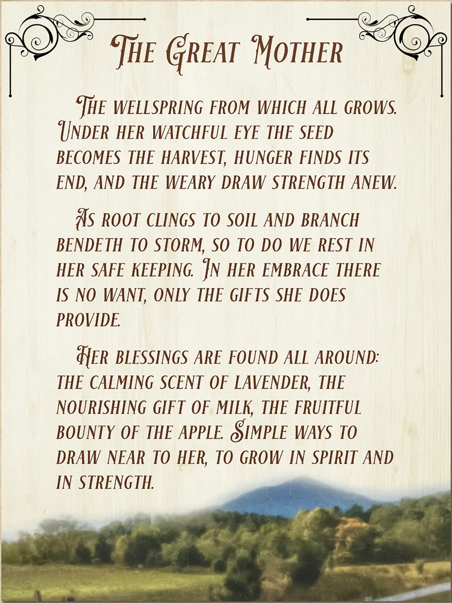

> **Раздатка 2. Табличка «Великая Мать»**
>
> Великая Мать
>
> Источник, из которого растёт всё. Под её бдительным оком семя становится урожаем, голод находит конец, а усталые вновь набираются сил.
>
> Как корень держится почвы и ветвь гнётся под бурей, так и мы покоимся под её защитой. В её объятиях нет нужды — лишь дары, что она даёт.
>
> Её благословения повсюду: успокаивающий аромат лаванды, питательный дар молока, щедрый плод яблока. Простые пути приблизиться к ней, вырасти духом и силой.
