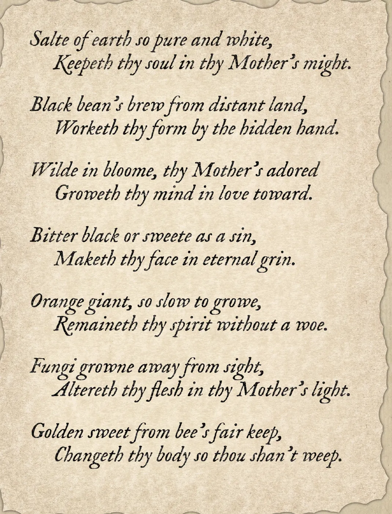

> **Раздатка 3. Страница с потешками**
>
> Соль земли, чиста, бела,  
> Душу в силе Матери держит она.
>
> Отвар чёрных бобов из дальней земли  
> Форму твою тайной рукой лепит.
>
> Дикий цвет, Матери любимый,  
> Разум твой растит в любви.
>
> Горький чёрный иль сладкий, как грех,  
> Лицо твоё вечно в улыбке застынет.
>
> Оранжевый великан, что так медленно растёт,  
> Дух твой без горя оставит.
>
> Грибы, растущие вдали от глаз,  
> Плоть твою изменят в свете Матери.
>
> Золотая сладость из пчелиной кладовой  
> Тело твоё изменит, чтоб ты не плакал.
