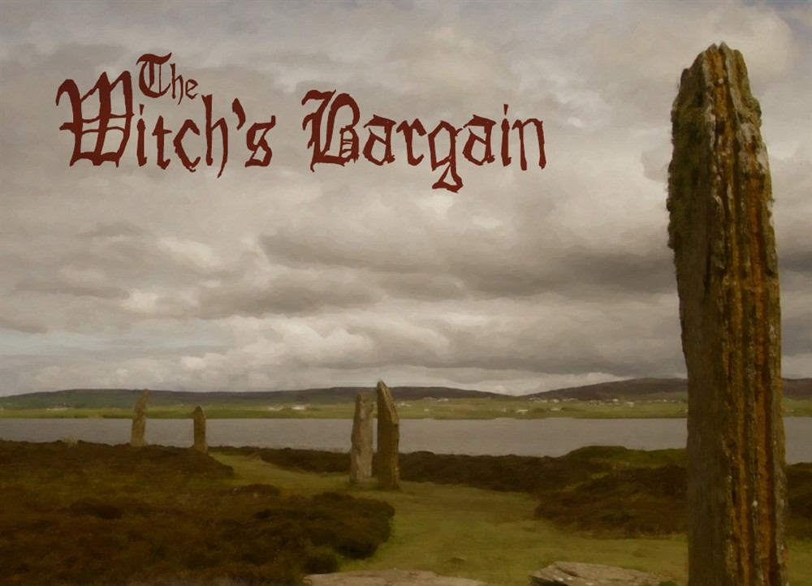

# Сделка ведьмы

*Сценарий Дэвида Уолдрона для «Зова Ктулху: Тёмные века»*  
*Сыщиков: 5 • Время игры: 2–4 часа*

*Прим. перев.: «Тёмные века» указаны в оригинале; действие происходит в 1640-х годах, во время Гражданской войны в Англии.*

## Введение

В Вальпургиеву ночь, среди населённых призраками Топей Саффолка времён Гражданской войны в Англии, горстке отчаявшихся беглецов предстоит выбор: служить древнему ужасу или стать его добычей.

Сыщики — бывшие солдаты, ставшие разбойниками в хаосе Гражданской войны. У каждого свои грехи. Украв деньги, предназначенные для помощи окрестным деревням, они бегут в окутанные туманом Топи, а по пятам за ними идёт призрачный чёрный пёс. Среди обманчивых болот каждому предстоит пережить личные испытания, столкнуться со сверхъестественным и увидеть мучительные видения, в которых оживают его грехи.

Таинственная ведьма, служащая Шуб-Ниггурат, предлагает им путь к силе и спасению. Она испытает их преданность Чёрной Козе Чащоб, а в конце поставит перед выбором: стать её прислужниками или пищей на её пиру.

## Предыстория

### Гражданская война в Англии

Гражданская война в Англии (1642–1651) была жестокой и ввергла страну в политический хаос. Ожесточённая борьба между войсками короля Карла I и английского парламента шла из-за разногласий о власти и религии между сторонниками короны и парламента. Война расколола семьи, превратила соседей во врагов и вызвала религиозные чистки против еретиков и тех, кого подозревали в колдовстве.

### Религия и вера

В основе Гражданской войны лежал религиозный конфликт, назревавший со времён Реформации. Пуритане, в основном стоявшие на стороне парламента, выступали за более простое и строгое богослужение. Роялисты, напротив, поддерживали
