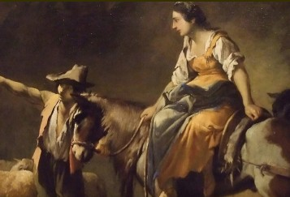

иерархию англиканской церкви, её связь со старыми традициями и обрядами. В Норфолке пуританские общины особенно активно участвовали в конфликте: их проповеди пестрели рассказами о сверхъестественном, а религиозные чистки становились всё беспощаднее.

### Колдовство и суды над ведьмами в Восточной Англии

Воспользовавшись религиозной рознью и политическим хаосом, самопровозглашённый генерал — искатель ведьм Мэтью Хопкинс развернул в Восточной Англии охоту на подозреваемых в колдовстве. С 1644 по 1647 год Хопкинс и его сообщники подвергли жестоким допросам и суду сотни людей, главным образом женщин. Признания, вырванные пытками и лишением сна, привели к массовым казням, усугубив бедствия местных жителей, и без того измученных войной.

> В 1642 году начались гражданские войны, и одним из их непредвиденных последствий стало то, что вопрос о колдовстве вновь приобрёл остроту.
>
> — Дж. А. Шарп. *Instruments of Darkness: Witchcraft in England 1550–1750*. Hamish Hamilton, 1996.

### Чёрные псы в британском фольклоре

В раннее Новое время Чёрный Шак, потустороннее существо, часто появлялся в местных преданиях. Его описывали как огромного пса с горящими красными глазами; встреча с ним предвещала смерть и несчастье. Один из самых известных рассказов относится к 1577 году. Пуританский проповедник-мирянин Абрахам Флеминг утверждал, что во время грозы Чёрный Шак ворвался в церковь Святой Марии в городе Бангей, убил двух прихожан и оставил на двери подпалины.

> И тотчас пред собравшимися там явилось в страшнейшем облике подобие пса, сколько они могли рассудить, чёрного цветом. И от вида его, и от ужасных вспышек огня, в тот миг виденных, пришли собравшиеся в такое смятение, что почли, будто уже настал Судный день.
>
> — Абрахам Флеминг, *A Straunge and Terrible Wunder*. Цит. по: Дэвид Уолдрон и Кристофер Рив, *Shock! The Black Dog of Bungay: A Case Study in Local Folklore*. Hidden Publishing, 2010.

## О сыщиках

Ограбление, с которого начинается сценарий и из-за которого сыщики бегут в Топи, устроила Изобел Вэнс. Где будет карета, она узнала от отца Томаса Блэквелла. К ним примкнули Маргарет Лейтон и Агнес Уитлоу: нужда довела их до разбоя на большой дороге. Эдмунда Хока взяли ради его силы. Когда ограбление срывается, каждый подозревает остальных и ищет виноватого.

Несмотря на разлад, сыщики заключили шаткий союз: так выгоднее всем. Никто не доверяет остальным до конца, но все понимают: поодиночке им конец. Вместе есть шанс выжить.

### Агнес Уитлоу, 34 года

*Лекарка-убийца*

Агнес была уважаемой лекаркой, но ей пришлось уйти в изгнание после того, как она из жалости лишила жизни мучившегося больного. Теперь она скитается по деревням, предлагая врачебную помощь и борясь с памятью о своих грехах.

**Черты:** практичная, находчивая, всегда ищет самый действенный выход. Внешне она ожесточилась, но вина не отпускает её. Говорит прямо, действует решительно и превыше всего ставит выживание.

**Подсказки для отыгрыша:** Агнес согласилась на ограбление от отчаяния и по-прежнему лечит товарищей, которым без неё не обойтись.

### Эдмунд Хок, 45 лет

*Предатель*

Крепкий, покрытый шрамами наёмник с седыми прядями в каштановых волосах, острым клинышком бороды и усами. Однажды Эдмунд продал товарищей и с тех пор бежит от последствий своего выбора.

**Черты:** эгоист и манипулятор; вечно ищет, кого использовать. Алчность заглушает в нём и честь, и товарищество. Он яростно охраняет своё добро и во всём прежде всего ищет личную выгоду.
