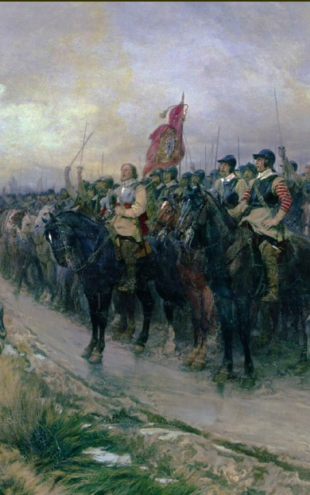

## Неудачный налёт

Война сделала сыщиков изгоями. Она же заставила их творить жестокости, немыслимые в мирное время. Когда-то одни сражались за короля, другие за парламент, третьи за веру. Теперь каждый бьётся лишь за то, чтобы выжить.

### Битва и предательство

Сценарий начинается сразу после неудачного налёта на карету роялистов. Прочтите или перескажите:

> Схватка была недолгой, но жестокой. Вы устроили засаду на обоз в надежде на лёгкую наживу и слишком поздно заметили стражу, шедшую следом. После отчаянного боя вы бежали на восток вдоль реки Уэйвни, в Топи. В глубине болот вам удалось оторваться от солдат, но не все ушли целыми.

Бросьте за каждого сыщика 1d10, чтобы узнать, какую рану, если она есть, он получил в стычке. Если сыщики найдут время заняться ранами, их можно перевязать с помощью Первой помощи; при тяжёлых ранениях может понадобиться Медицина.

| 1d10 | Рана | Последствия |
| --- | --- | --- |
| 1 | Легко отделался: только мелкие ссадины и синяки. | В правилах эффекта нет, но одежда порвана, сыщик весь в грязи и крови. |
| 2 | Мушкетная пуля прошла вскользь, задев плечо или ногу. | −1d3 ПЗ. Проверки ЛВК, в которых задействована эта конечность, получают штрафную кость до конца сценария, если рану не вылечить. |
| 3 | Глубокий порез: клинок вошёл в бок. | −1d4 ПЗ. Проверки ВЫН получают штрафную кость до конца сценария, если не вылечить заражение. |
| 4 | Ушиб: удар прикладом вышиб из сыщика дух. | −1d4 ПЗ. Трудная проверка ВЫН, чтобы избежать временного штрафа к ЛВК (−10%) на первую часть. |
| 5 | Нож пронзил ладонь насквозь. | −1d3 ПЗ. Ближний бой (драка) и другие навыки, требующие работы руками, получают штрафную кость до конца сценария, если рану не вылечить. |
| 6 | Трещина в ребре: от сильного удара теперь больно двигаться. | −1d4 ПЗ. При попытке бежать или драться нужна проверка ВЫН; иначе действие выполняется со штрафной костью. |
| 7 | Огнестрельная рана: мушкетная пуля засела в руке. | −1d4 ПЗ. Проверки ВЫН, Ближнего боя (драка) и других навыков, требующих работы руками, получают штрафную кость до конца сценария, если не вылечить заражение. |
| 8 | Удар по голове вызвал сотрясение. | −1d4 ПЗ. Проверки МОЩ, Внимания и Слуха получают штрафную кость до конца сценария, если рану не вылечить. |
| 9 | Синяки и побои: сыщика избили, но серьёзных ран нет. | −1d2 ПЗ. Тело ноет и плохо слушается, но длительных штрафов нет. |
| 10 | Растяжение: при падении сыщик подвернул лодыжку. | −1d3 ПЗ. Проверки ЛВК и связанных навыков, в которых задействована эта нога, получают штрафную кость до конца сценария, если травму не вылечить. |
