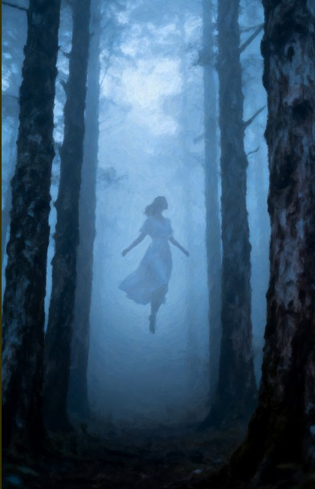

- **Эдмунд** смотрит из-за дерева, как роялисты крадутся к лагерю его полка. Его рука сжимает кошель с золотом. Он молчит.
- **Маргарет** видит, как муж с криком колотит в дверь; на её руках кровь. Сама она стоит внутри ни жива ни мертва и молча смотрит на дверь.
- **Томас** стоит на коленях у разбитого реликвария святого Томаса Бекета; его лицо искажено виной. За спиной призрачные монахи осуждающе отворачиваются от него.
- **Изобел** глядит сквозь заиндевевшее окно на семью, сбившуюся в кучку, и прижимает к себе мешок зерна.

Увидев отражения, каждый сыщик проходит проверку Рассудка (потеря 0/1d3).

## Часть II. Испытания ведьмы

Вторая часть начинается, когда сыщики увидят в круглом пруду свои самые мрачные воспоминания. Возможно, они уже потеряли столько Рассудка, что не верят собственным глазам. Они могут спорить, набрасываться друг на друга или впадать в крайнее отчаяние. По мере того как напряжение растёт, прежние грехи обретают плоть. Каждому предстоит нравственное испытание: достоин ли он Шуб-Ниггурат?

### Сцена 1. Призрачная деревня

Мерцающие огни проводят сыщиков сквозь туман к горящей деревне. Воздух густ от дыма, вдалеке слышны крики. Солдаты в изодранных пуританских одеждах врываются в дома и вытаскивают на улицу перепуганных женщин, обвиняя их в колдовстве.

Место кажется сыщикам странно знакомым. Посреди суматохи к виселице волокут женщину; её лицо в крови и синяках. Она то проклинает своих мучителей, то умоляет о пощаде. Толпа скандирует: «Смерть ведьме! Очистим землю!»

Осмотрев деревню, сыщики могут пройти проверку Оккультизма или трудную проверку ИНТ: при успехе становится ясно, что деревня — иллюзия, которую Топи соткали из общей боли. Если присмотреться, виселица сложена из костей и грибов. Лица селян меняются, становясь похожими на тех, кого сыщики знали при жизни.

Те, кто распознал видение, проходят проверку Рассудка (потеря 0/1d4), зато понимают: ни драка, ни спасение женщины ничего не изменят. Важно лишь то, что сыщики поймут.

Что будет дальше, решают сыщики. Ниже — самые вероятные варианты.

#### Вмешаться

Если сыщики вступают в бой, их быстро одолевают. Пуританских охотников на ведьм не меньше двенадцати. Это не смертные люди, а порождения Топей, неумолимое эхо фанатизма. Они не отступают, и уничтожить их нелегко.

Если сыщики потеряют сознание, погибнут или сбегут, то позже очнутся в Топях. Женщина исчезла, но её гибель и собственная неспособность спасти её не дают им покоя. Нужна проверка Рассудка (потеря 1/1d3).

#### Прокрасться

Успешная групповая проверка Скрытности позволяет увести женщину, но сначала нужно отвлечь толпу.
