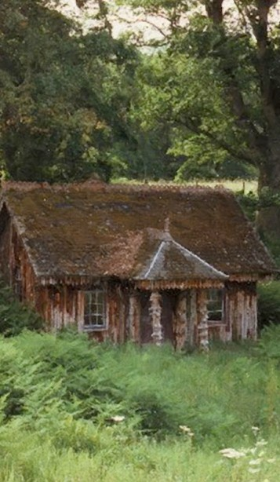

##### Агнес Уитлоу

Лилит хвалит Агнес за то, что та ясно видит: милосердие бывает жестоким.

> Ты увидела то, чего другие не смогли увидеть: чтобы выжить, порой приходится делать тяжёлый выбор. Зачем тебе страдать за то, что ты поняла то, на что другие боятся даже взглянуть?

- Если Агнес оправдывает свой поступок, Лилит с почтением признаёт её правоту.
- Если Агнес раскаивается, Лилит убеждает её отпустить стыд: от него никому нет пользы.

##### Эдмунд Хок

Лилит представляет предательство как освобождение от пустых идеалов.

> Верность — это клетка. Ты разорвал цепи и выжил. А они ради тебя на такое пошли бы?

- Если Эдмунд соглашается, Лилит отдаёт должное его силе.
- Если он сомневается, она напоминает: мёртвым честь ни к чему.

##### Маргарет Лейтон

Лилит хвалит Маргарет за её волю к жизни.

> Одна жизнь оборвалась. Но ты выжила. Разве оно того не стоило?

- Если Маргарет принимает свой выбор, Лилит называет её мудрой.
- Если Маргарет не соглашается, Лилит замечает, что вина — роскошь, доступная живым.

##### Томас Блэквелл

Лилит называет отказ Томаса от обряда духовным пробуждением.

> Ты отбросил пустые побрякушки веры, чтобы остаться в живых. Что может быть честнее?

- Если Томас держится за свои убеждения, Лилит обвиняет его в том, что он цепляется за символы, которые его предали.
- Если он сомневается, она предлагает простую истину: главное — выжить.

##### Изобел Вэнс

Лилит считает, что кража Изобел в порядке вещей.

> Ты взяла то, что тебе было нужно. Будь вы на месте друг друга, разве они пощадили бы тебя?

- Если Изобел терзается, Лилит убеждает её не оплакивать тех, кто не стал бы оплакивать её.
- Если Изобел соглашается, Лилит хвалит её за трезвый взгляд на вещи.

#### Принять или отказаться

Когда сцена подходит к концу, сыщиков вновь окутывает туман. Они слышат голос Лилит:

> Вы видели, как меня связали. Как глумились надо мной, будто я падаль. Такой я была. Такими мы все предстаём перед их Богом и их королём. Петля впилась мне в горло, я ощутила на языке пепел их огня. И всё же… вот я стою перед вами.
>
> Я была их ведьмой. Их еретичкой. Их добычей. Они сломали моё тело, но земля приняла меня. Тогда пришла Она. Мать в Лесу, Коза Многих Детей. Она прошептала мне из земли под виселицей, и я восстала.
>
> Давайте посеем другое семя. Свалим их кресты, низвергнем их королей, разрушим их каменные церкви, чтобы плющ поглотил их мёртвые остовы. Возьмите Её за руку, и вместе мы вырвем этот мир с корнями, до самых костей, и посадим новое в земле, напитанной кровью.
