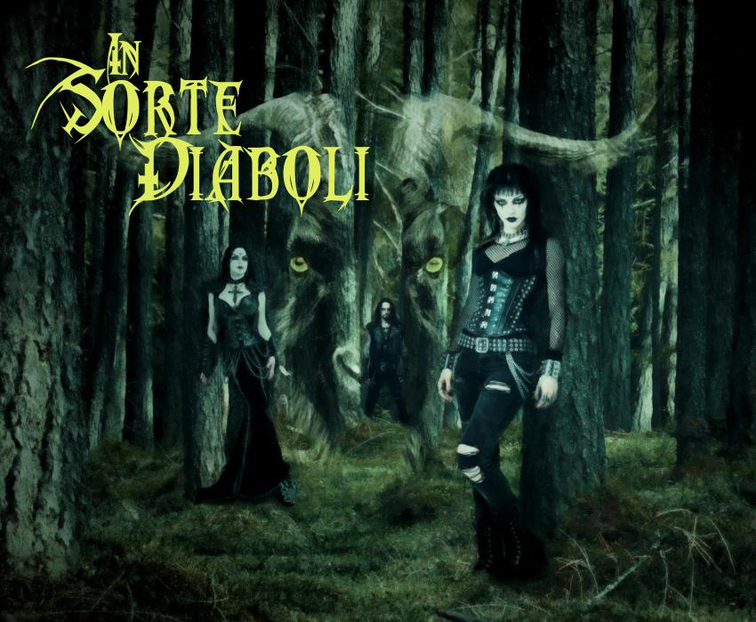

# In Sorte Diaboli

*Сценарий Джейсона Грина для «Зова Ктулху» в современную эпоху.*

**Сыщики:** 3–5 • **Время игры:** 2–3 часа

## Введение

Весна 1995 года. Все сыщики играют в метал-группе. Они отправились в глухой древний лес, чтобы снять новый клип. Ни музыканты, ни съёмочная группа не знают, что в лесу обитает аватар Шуб-Ниггурат, великий бог Пан, а с ним — подвластные ему дикие люди. Пан не прочь позабавиться: сорвать съёмки и превратить музыкантов в диких людей. Чтобы выбраться из леса живыми, им придётся пустить в ход всё своё мастерство, а может быть, и свои инструменты.

## Предыстория

После золотого века восьмидесятых метал не сбавил оборотов: следующее десятилетие принесло новые сочетания стилей и звучаний. Группа из этого сценария — восходящая звезда метал-сцены. На её концертах дома аншлаги, а гастролирует она по всей Финляндии и Скандинавии. Альбом уже записан, и музыканты решили снять клип в одном из древнейших лесов Финляндии. С него начнутся их самые масштабные гастроли по континентальной Европе.

Койрайоки (произносится «КОЙ-ра-йо-ки») лежит на северо-восточной окраине национального парка Саламаярви («САЛ-ама-яр-ви»),
