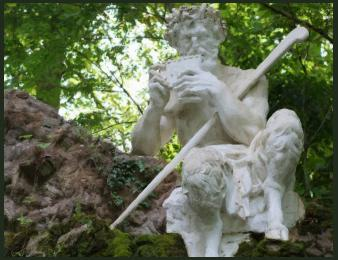

обширного соснового леса, раскинувшегося в центральной Финляндии. Это один из древнейших и наименее тронутых человеком лесов страны. Государство охраняет его с 1912 года. Больше о здешней природе можно узнать на [сайте Luontoon](https://www.luontoon.fi/en/destinations/salamajarvi-national-park/nature).

### Великий бог Пан

Пан, аватар Шуб-Ниггурат, веками властвует над Койрайоки и упивается поклонением тех, кого преобразил. По лесу рыщут стаи диких людей — одичавших и извращённых подобий тех, кем они были прежде. Они пируют, пьют и охотятся, и всё это под звуки свирели Пана.

### Проклятые головные уборы группы

Ни музыканты, ни съёмочная группа не подозревают, что Пан наблюдает за ними с тех пор, как они прибыли и заиграли. Аватар проклял маски и прочие головные уборы музыкантов — ключевую часть их сценического образа. Едва группа начинает играть, маски начинают превращать музыкантов в диких людей. По мере превращения у них могут появиться новые силы и способности: чувства обостряются, тело крепнет, но расплачиваются они за это человечностью. Все правила этого превращения приведены ниже, в разделе ПНачало превращения».

### Музыкальное мастерство группы

Источником великой силы Пана служит его свирель. Но есть и другой могучий, чудовищный звук, способный ей противостоять: хеви-метал. Пан не учёл музыку своих новых жертв. Если группа поймёт, какую власть её инструменты имеют над великим богом, у музыкантов будет больше шансов одолеть его и уйти из его владений живыми. Правила приведены ниже, в разделе ПСила музыки».

## О группе

Ниже — описания всех участников группы. Если игроков меньше пяти, отметьте, кого из музыкантов они не выбрали: эти персонажи всё равно появятся в первой сцене (см. ППровал в памяти»).

### Теро/Тарья Туонела, 27 лет

*Ведущий вокалист*

Ты — голос и лицо группы. Разумеется, ты её самый эффектный участник и гордишься своей внешностью. Ты любишь тренироваться, и это заметно. Твоё тело украшают татуировки и пирсинг.

**Черты:** Твой пыл никого не оставляет равнодушным: одних он вдохновляет, других пугает, третьих раздражает.

**Зацепки для отыгрыша:** Тебе не терпится снять новый клип и покрасоваться перед поклонниками.

### Яри/Яана Хелланд, 26 лет

*Гитарист*

Ты пишешь песни и служишь творческим двигателем группы. Вот только на тебя трудно положиться, а распорядок дня для тебя пустой звук. Ты то и дело забываешь поесть (про выпивку, конечно, никогда), оттого и выглядишь измождённо.

**Черты:** Когда работа спорится, ты весь в ней. В творческом застое ты впадаешь в тоску и споришь со всеми подряд. Ты перфекционист.

**Зацепки для отыгрыша:** Несмотря ни на что, альбом наконец готов, и тебе снова хочется показать его всему миру.

### Сами/Саара Пасанен, 34 года

*Бас-гитарист*

На тебе держится группа — и в музыке, и в отношениях. Ты ведёшь дела, о которых остальные предпочитают не думать. Ты старше всех, и для остальных ты почти родитель: тебе не раз приходилось присматривать за кем-то из младших, когда те перебарщивали с выпивкой, наркотиками или с тем и другим.

**Черты:** Ты добр, решителен, бесстрашен и не даёшь своих в обиду. Твоя сила — в самообладании.

**Зацепки для отыгрыша:** Ты лучше остальных понимаешь, как много значит этот клип для будущего группы.

### Юкка/Яна Невала, 28 лет

*Ударник*

С виду ты грозный великан. На деле ты добряк, которому хочется просто играть вместе и веселиться. Когда музыканты начинают ссориться,
