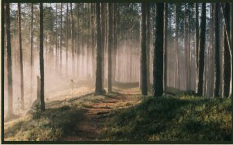

именно ты их разнимаешь. С тобой легко найти общий язык: ты обаятелен и любишь компанию.

**Черты:** Ты душа компании, держишься непринуждённо и никогда не напрягаешься.

**Зацепки для отыгрыша:** Поиграть со своей группой, нарядиться в крутые костюмы и подурачиться в лесу — да кому такое не понравится?

### Ээро/Эмми Пакканен, 26 лет

*Клавишник*

Ты главный технарь группы. Ты не только играешь на клавишах, но и руководишь записью, работой над звуком и съёмками. Правда, преданность ремеслу отточила твои технические навыки куда лучше, чем умение ладить с людьми.

**Черты:** Ты человек дела, а не слова. Но стоит подвернуться случаю, и тебя не остановить: ты готов часами рассуждать о технических тонкостях, даже если слушаешь себя только ты.

**Зацепки для отыгрыша:** Снять клип в лесу — непростая техническая задача. Тебе не терпится с ней справиться.

## Действующие лица

### Дикие люди, одичавшие почитатели

Веками Пан заманивал беспечных путников и податливых жителей окрестностей. Когда жертвы всецело попадали во власть леса, они становились дикими людьми — тенями самих себя. Они не помнят прежней жизни и живут лишь настоящим, славя своего бога то в азарте охоты, то в упоении безумного разгула.

**Черты:** Алчные, кровожадные, жестокие и вспыльчивые. Во всём повинуются нескладной музыке Пана.

**Зацепки для отыгрыша:** Поначалу они радушно принимают музыкантов как новых собратьев, которые вот-вот станут своими. Потом берут верх первобытные инстинкты, и от группы им нужно одно: сытный обед.

### Пан, аватар Шуб-Ниггурат

Пан — рогатое человекоподобное существо, похожее на козла, ростом около 2,75 м, с обнажённой грудью, мохнатыми ногами и раздвоенными копытами. В людских мифах он бог дикой природы и покровитель животных, связанный с похотью, плодородием и приходом весны. Истина куда мрачнее. Этот аватар — одно из воплощений Шуб-Ниггурат. Пан олицетворяет саморазрушение под личиной удовольствия и излишеств. Оставленный без присмотра лес дичает, и точно так же Пан с наслаждением завладевает человеческим разумом, превращая прежде добрых людей в чудовищные подобия самого себя.

**Черты:** Пан — сластолюбец и манипулятор. Своей свирелью он дразнит, пугает и сбивает с толку.

**Зацепки для отыгрыша:** Пан преображает всех, кто вторгается в его леса, намеренно или по ошибке. Одни при этом гибнут. Другие становятся новыми почитателями аватара. Спастись удаётся редким счастливцам.

## Сбор группы

Выбрав персонажей, игроки должны придумать название группы и её сценический образ: как выглядят костюмы и инструменты. Поощряйте выдумку и не бойтесь переборщить. Для вдохновения посмотрите на Dimmu Borgir, Chthonic, Sabaton и Fleshgod Apocalypse.

### Головные уборы

В сценический костюм каждого музыканта входит головной убор. Это может быть маска, корона или что угодно ещё. Каждый убор задуман по-своему и отражает характер и увлечения владельца. Когда группа определится со своим внешним видом, попросите каждого игрока описать свой головной убор и его характерные детали.

### Звёзды рождаются

Когда группа будет готова, прочитайте следующее:

> Весна 1995 года. Вы играете в финской метал-группе, которая стремительно набирает известность. За последние годы у вас случались и взлёты, и падения, но публика любит вас и вашу музыку. Дома вас хорошо знают: вы регулярно собираете полные клубы и концертные залы по всей стране и в соседней Скандинавии. Секса, наркотиков и выпивки у вас всегда в избытке.
>
> Сейчас вы готовитесь к турне по Европе и решили начать его с клипа на вашу новую песню. Клипы вы, конечно, уже снимали, но на этот раз размах совсем другой. Съёмки пройдут на натуре, в древних лесах Финляндии. Вы заказали специальные костюмы и наняли профессиональную съёмочную группу.

