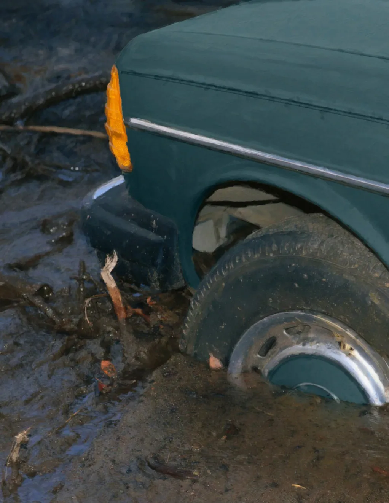

### Спасение машин

Чтобы убежать пешком, времени хватит. Спасти машины — другое дело.

- Легковушки целиком уходят под землю за 4 раунда, фургон — за 5. Чтобы вытолкнуть или вытянуть машину, нужна проверка СИЛ против ТЕЛ 150 (легковушка) или 200 (фургон); с каждым раундом сложность повышается на одну ступень (см. с. 88–89 «Книги хранителя»). Надёжнее сесть за руль и попробовать выехать, если машину успели починить.
- Чтобы вывести машину с зыбкой почвы, надо выехать с поляны с успешной проверкой Вождения автомобиля. Если машина погружается уже больше одного раунда, нужна трудная проверка Вождения автомобиля.
- Музыканты могут попытаться забрать вещи из машины. Чтобы успеть залезть и вылезти за один раунд, нужна проверка Лазания или трудная проверка ЛВК. При провале персонаж понимает, что не успеет, либо не находит ничего ценного. Если он делает повторную проверку, то может застрять: пока машина уходит под землю, он получает 1d4 урона в конце каждого раунда.

## Акт II. Полночное безумие

Пробираясь по лесу, группа натыкается на сборище диких людей, предающихся пьяному разгулу. В конце концов под звуки свирели Пана одичавшая орда набрасывается на музыкантов, и им снова приходится спасаться бегством.

### Сборище

Отойдя от того, что осталось от съёмочной площадки, музыканты вскоре понимают, что заблудились. Дороги, по которым они приехали, переместились и теперь упираются в поляны, которых раньше не было. В этот момент разрешите проверки Слуха (со штрафной костью, если музыканты едут в машине). При успехе слышны недалёкий смех, непристойные песни и довольные стоны. Звуки издаёт большая ватага диких людей посреди разгула. Взобравшись на дерево, можно издали разглядеть и самих гуляк, и тёплое зарево костра. Музыканты могут попробовать обойти сборище стороной, но тогда наткнутся на другую ватагу, которая как раз идёт туда.

### Вторжение на праздник

Если вся группа провалила проверки Слуха, музыканты выходят или выезжают прямо на сборище. Если они в машине, попросите водителя пройти проверку Вождения. При успехе он успевает затормозить, никого не задев. При провале машина насмерть сбивает одного из диких людей. Остальные приходят в ярость, тут же облепляют машину, а когда она вырывается, бросаются следом. В этом случае сразу переходите к разделу «Свирель умолкает».

### Секс, наркотики и рок-н-ролл

Дикие люди собрались у древнего дерева, из которого сочится что-то вроде смолы. Другие столпились вокруг большого костра: пляшут, совокупляются или едят мясо только что убитого северного оленя. Это зрелище требует проверки Рассудка (потеря 0/1d2). Со всех сторон доносится завораживающий напев свирели. Стоит прислушаться, и музыканты узнают ту самую свирель, которая звучала на съёмках перед тем, как они потеряли сознание.

### Ранцевая рация

У одного из пирующих за спиной закреплена старинная переносная рация Feldfu. c. Вблизи любой музыкант заметит на ней надписи по-немецки. Успешная проверка Слуха позволяет различить тихое шипение: рация всё ещё работает.
