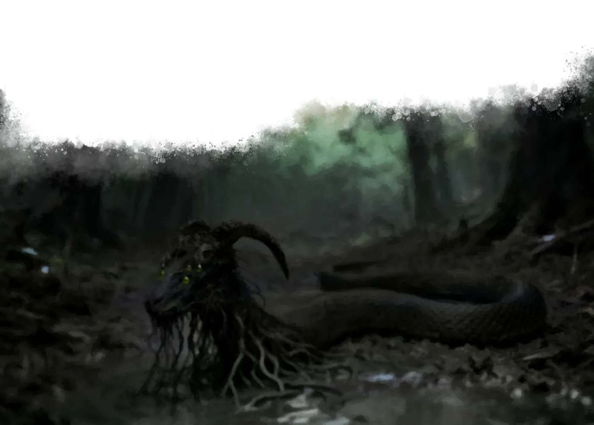

> **Паника**
>
> **Цена:** 10 ПМ, затем 5 ПМ за каждый последующий раунд.
>
> **Время сотворения:** 1 раунд.
>
> Это мощное заклинание поражает всех в радиусе 10 м. Их душевная стойкость рушится под натиском неудержимой паники. Все поражённые теряют 1d6 Рассудка. Если у кого-то из музыкантов случается приступ безумия, попросите его пройти проверку ВЫН. При провале у него начинается сердечный приступ, который не прекращается, пока Пан не получит урон. При критическом провале приступ мгновенно убивает персонажа.

### Появление Пана

Как бы группа ни попыталась справиться с дикими людьми, ей предстоит столкнуться с самим аватаром. Пан может преградить музыкантам путь к бегству или появиться после того, как они одолеют или разгонят диких людей.

Пан медленно поднимается перед ними из болота. Обретя плоть, он атакует навыком «Ближний бой (лес)». Как обычно, очерёдность определяется ЛВК, но ход последней битвы зависит от тактики группы.

### Щедрый бог

Музыканты могут продолжать отбиваться оставшимся оружием или воспользоваться дарованными богом силами, чтобы продержаться против Пана. Пан предпочитает не торопить развязку: пусть музыканты доведут своё превращение до конца сами. Кто полностью преобразится во время боя, тут же подпадёт под власть Пана и перейдёт на его сторону. Тех, кто устоял, Пан уважает: он предлагает им присоединиться к нему и искушает их, зная самые сокровенные желания каждого. В случае отказа он постарается одарить их медленной, мучительной смертью.

### Битва групп

Если музыканты используют Силу музыки, начинается битва групп. Чтобы музыкальная атака причинила Пану урон, группа должна превзойти его МОЩ по тому же принципу, по которому проверяют СИЛ с учётом пределов человеческих возможностей. Только вместо СИЛ и ТЕЛ сравнивают «Искусство/ремесло (музыка)» музыкантов с МОЩ Пана. Ни одна сторона не может уклониться от атаки другой. При успешной музыкальной атаке группа наносит 1d20 урона.

### Как одолеть Пана

Пана можно измотать обычными атаками или Силой музыки. Второе проще, но всё равно нелегко. При 0 ПЗ Пан вскрикивает и уходит под землю в клубах чёрного тумана. Если свирель уцелела, она падает на мягкую траву. Какое-то время Пан больше никого не будет мучить.

### Уничтожение свирели

Пан могуч, но именно свирель даёт ему силу и позволяет творить заклинания. Музыканты могут целиться прямо в неё, однако требуемая степень успеха повышается на одну ступень. Это касается и атак Силой музыки.

Если свирель уничтожить или вывести из строя, Пан больше не сможет удерживать прежнюю силу и облик. Он обращается в чёрного ужа с уродливой козлиной головой и сотнями мелких, суетливо перебирающих отростков. Уж юркает в ближайшую топь и скрывается под илом. По воде стелется тёмный туман, из него доносятся визги и блеяние, пока туман мало-помалу не рассеивается и всё не стихает.

