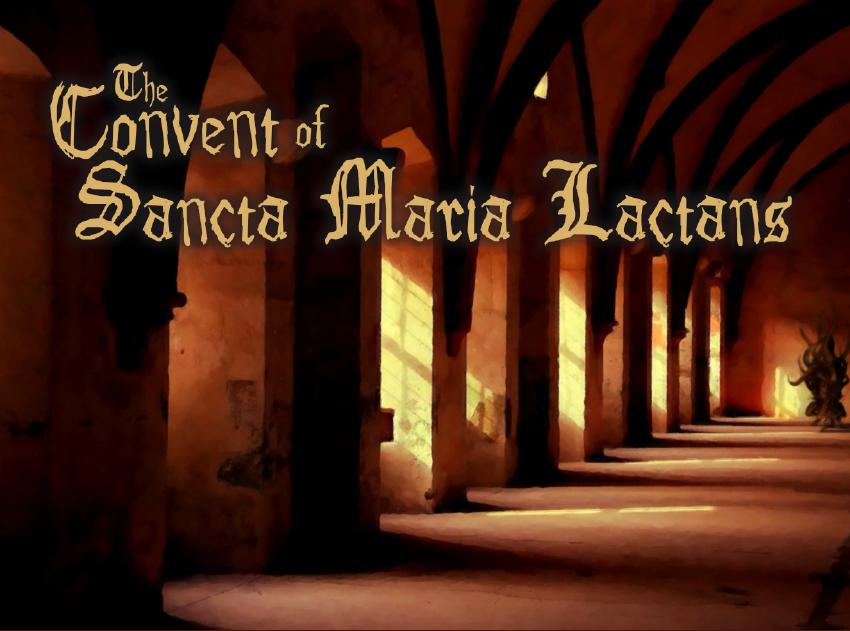

# Монастырь Санкта Мария Лактанс

*Сценарий Робина Уорти для «Зова Ктулху: Тёмные века».*

**Сыщики:** 2–4 • **Время игры:** 3–4 часа

## Введение

Идёт 1526 год. Генрих VIII, Божией милостью король Англии и Франции, защитник веры и государь Ирландии, начинает сомневаться в своём браке с королевой Екатериной Арагонской. Томас Кромвель, восходящая звезда при дворе Генриха, видит в желаниях короля возможность возвыситься. Услышав толки о тёмных, богохульных обрядах в монастыре под покровительством королевы, он хватается за возможность очернить её имя и добивается назначения визитации.

### Структура сценария

Сценарий разделён на акты и постепенно подводит к последнему, ужасному открытию: что на самом деле творится за стенами монастыря.

**Акт I.** Сыщикам поручают осмотреть монастырь. Они могут собрать сведения, чтобы подготовиться к делу.

**Акт II.** Отважные сыщики добираются до монастыря и начинают осмотр.

**Акт III.** Любопытство до добра не доводит: сыщики узнают правду и, если благоразумны, пытаются бежать с этим знанием от культа Санкта Мария Лактанс.

**Кульминация.** Всё против сыщиков. Им суждено стать жертвами Тёмной Матери Шуб-Ниггурат, если только удача и впрямь не благоволит тем, кто сохранил рассудок.

**Эпилог.** Наши храбрые сыщики получают награду, и раскрывается тёмная тайна.
