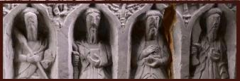

## Акт I

В первом акте сыщики проверяют зацепки, полученные от кардинала Уолси и Томаса Кромвеля, и посещают Судебные инны и Лондонский Тауэр. Полученные там сведения направят их в другие места. Акт заканчивается, когда сыщики завершают изыскания и отправляются в монастырь. Всё, что они пропустили или упустили из виду, может сообщить Томас Кромвель. При необходимости он даст и дальнейшие указания.

### Судебные инны

Фахверковые дома окружают внутренний двор, а весь комплекс обнесён стеной. По поручению кардинала Уолси сыщиков пропускают без задержки. Их направляют к хранителю записей: он ведает судебными документами и знает о них решительно всё. Пожилой господин, сгорбившийся за годы работы над бумагами, сидит среди увесистых книг в кожаных переплётах. С бумагами ему куда лучше, чем с людьми; он обрёл своё место среди предписаний и реестров тюдоровского правосудия. Стоит сыщикам спросить о монастыре Санкта Мария Лактанс, как его запачканные чернилами пальцы быстро отыщут нужные документы:

- Раздатка 1 — дарственная королевы Екатерины Арагонской, передающая земли монастырю Санкта Мария Лактанс.
- Раздатка 2 — дарственная сэра Джеффри Болейна, передающая земли монастырю восемьюдесятью годами ранее. Если сыщики расспросят о сэре Джеффри и успешно пройдут проверку навыка «Родное королевство (Англия Тюдоров)», они вспомнят, что он прадед будущей королевы Анны Болейн, преуспевающий купец, который приобрёл замок Хивер, родовое гнездо Болейнов.
- Раздатка 3 — старинная грамота, по которой некий Уильям из Черчилля пожаловал монастырю земли из своего поместья, вернувшись из Четвёртого крестового похода. Документ можно датировать либо по началу царствования короля Иоанна в 1199 году, либо по Четвёртому крестовому походу, длившемуся с 1202 по 1204 год. Сыщики, которые зададутся вопросом о любом из этих событий и успешно пройдут проверку Истории, вспомнят даты.

Сыщики должны понять, что дарственные важны: они свидетельствуют не только о тесной связи монастыря с Екатериной Арагонской, но и о его связи с семьёй Болейн. Кроме того, может показаться странным, что подпись матери-настоятельницы на всех документах одна и та же, хотя между ними лежат столетия. Хранитель записей весьма сведущ: при успешной проверке Обаяния или Убеждения он поможет сыщикам разобраться в этих связях. Если польстить его самолюбию, проверка получит бонусную кость.

### Лондонский Тауэр

Лондонский Тауэр — королевский дворец, крепость, тюрьма, зверинец и хранилище придворных записей. Его суровые каменные стены господствуют над городом, олицетворяя власть и величие короны. Сыщики проходят под арками и подъёмной решёткой ворот Байуотер. Их провожают к хранителю королевских записей Эдварду Сидкоку. Это щеголеватый молодой господин в дублете лесного зелёного цвета с прорезями, сквозь которые виден алый шёлк, и в пышном кружевном воротнике. В ответ на вопросы о монастыре Санкта Мария Лактанс он достаёт следующие документы:

- Раздатка 4 — счета паломничества королевы в монастырь Санкта Мария Лактанс, в том числе плата за платья и за врачебные консультации для одной из фрейлин.
- Раздатка 5 — счёт доктора Уильяма Баттса за консультации по поводу леди Элизабет Гранвиль и беременности королевы.

Наблюдательные сыщики могут заметить, что королева посетила монастырь в марте 1514 года, а в ноябре того же года, девять месяцев спустя, родила ребёнка с уродствами.

### Доктор Уильям Баттс

Сыщики, пожелавшие встретиться с врачом из раздатки 5, найдут его скромный дом в Фулеме: туда недолго плыть по Темзе. По прибытии сыщиков проводят в кабинет. Доктор Баттс — ревностный протестант и хочет проверить, разделяют ли гости его веру. Для этого он кладёт на стол запрещённую Библию Тиндейла, а затем поспешно её убирает. Сыщик, успешно прошедший проверку Внимания, замечает Библию и понимает намёк. Доктор Баттс куда охотнее отвечает единоверцам, и сыщики, открыто признавшиеся
