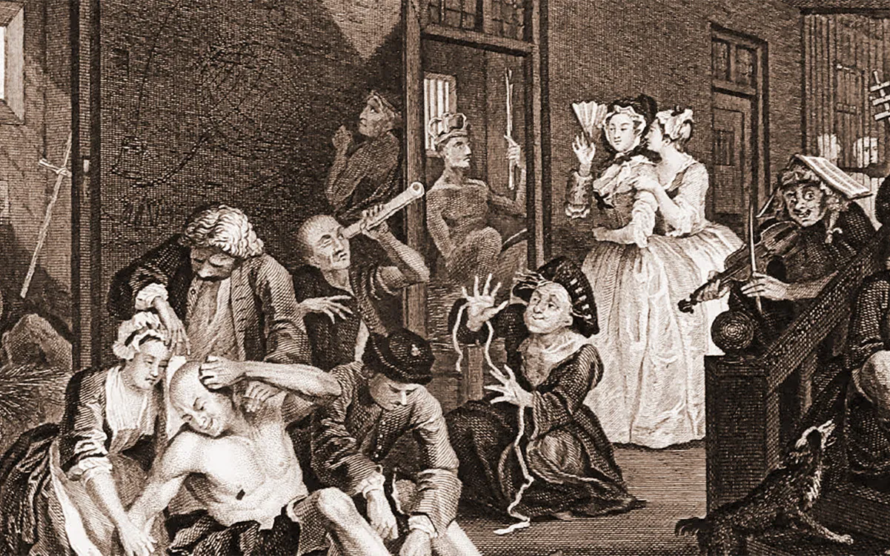

в своей протестантской вере, получают бонусную кость ко всем проверкам при общении с ним.

Доктор Баттс охотно отвечает на вопросы о состоянии леди Элизабет Гранвиль, симптомах и причине её недуга, если их задаёт другой врач. Тому потребуется успешно пройти проверку Медицины, чтобы показать доктору Баттсу, что он сведущ в лекарском деле. Иначе можно развязать ему язык проверкой Обаяния или Убеждения, но с человеком не из своего круга доктор поделится лишь самыми общими сведениями.

О беременности королевы добрый доктор говорит куда неохотнее, однако успешная проверка Обаяния или Убеждения и тут позволит его разговорить. Если и это не поможет, уместное «пожертвование» на врачебную практику тоже может принести сведения, приведённые ниже.

### Доктор Баттс о странном и тревожном случае леди Элизабет Гранвиль

> «Случай в высшей степени необычный. Рассудок бедной дамы был совершенно разрушен. Полагаю, во время королевского паломничества её слабое женское тело испытало чрезмерное напряжение, а внезапное потрясение окончательно лишило её связи с действительностью.
>
> К моему приходу её уже усмирили, но она всё ещё издавала ужаснейшие вопли и бормотала околесицу о фавнах, о дереве, которое пьёт, и о матери, что топит мир в своём молоке. Я заключил, что истерия вызвана нарушением равновесия гуморов, в данном случае избытком чёрной желчи. Увы, обычные средства не подействовали, и родные отправили бедняжку в Бедлам».

*Прим. перев.:* В оригинале здесь *fawns* («оленята»); по контексту имеется в виду *fauns* («фавны»), как в переводе записи базы.

Любой сыщик с медицинской подготовкой знает учение о четырёх гуморах и согласится, что меланхолию леди Гранвиль, должно быть, вызвал избыток чёрной желчи.

> Учение о четырёх гуморах было вершиной медицины эпохи Тюдоров и восходило к древнегреческим врачам. Считалось, что здоровье зависит от равновесия четырёх жидкостей тела: крови, флегмы, жёлтой и чёрной желчи. Болезнь объясняли нарушением этого равновесия, а восстанавливали его кровопусканием, диетой или слабительными.

### Доктор Баттс о беременности королевы

> «В ноябре 1514 года меня срочно вызвали в Вестминстерский дворец: роды королевы Екатерины не продвигались, и всерьёз опасались, что и она, и дитя погибнут. С моей помощью она разрешилась от бремени мальчиком, на редкость безобразно сложенным.
>
> Вместо ступней у ребёнка были скрюченные костяные отростки, видом своим более всего напоминающие копыта. Ноги и туловище покрывал сплошной ковёр свалявшихся тугих завитков, а половые органы были непомерно велики. Из них сочилась вязкая, приторно-сладкая на запах жидкость, похожая на свернувшееся молоко.
>
> К счастью, дитя прожило лишь несколько часов, и благом было то, что королева Екатерина лишилась чувств от тяжести родов. Она так и не увидела мерзость, которую произвела на свет».

Успешная проверка Проницательности показывает, что доктор Баттс рассказал о ребёнке не всё. Ещё одна успешная проверка, теперь Запугивания или Обаяния, позволит узнать правду: ребёнка убили по приказу кардинала Уолси, который, чтобы скрыть это, распорядился записать новорождённого мертворождённым.

### Посещение Бедлама

Сыщики могут посетить Бедлам после беседы с доктором Баттсом или сами, расследуя дело леди Элизабет Гранвиль. Повидать леди Элизабет нетрудно. В больницу часто ходят потехи ради поглазеть на больных и платят смотрителям за эту привилегию.

По сравнению с большинством больных леди Гранвиль содержат в прекрасных условиях. Солому на полу недавно сменили, в окно проникают свет и свежий воздух, на нетронутой еде не видно ни плесени, ни личинок.

Сама леди в жалком состоянии. Некогда роскошная одежда порвана и обветшала, от тела исходит тошнотворный кислый запах. Смотритель говорит, что она не принимает никакой пищи, кроме молока. Сыщики не услышат от неё ничего, кроме безумных речей о молоке и «матери». От дальнейших вопросов она приходит в возбуждение, разрывает платье, обнажает обвисшую, сморщенную грудь и подаётся к сыщикам, снова и снова выкрикивая: «Пейте молоко матери!» Это зрелище требует проверки Рассудка (потеря 0/1).
