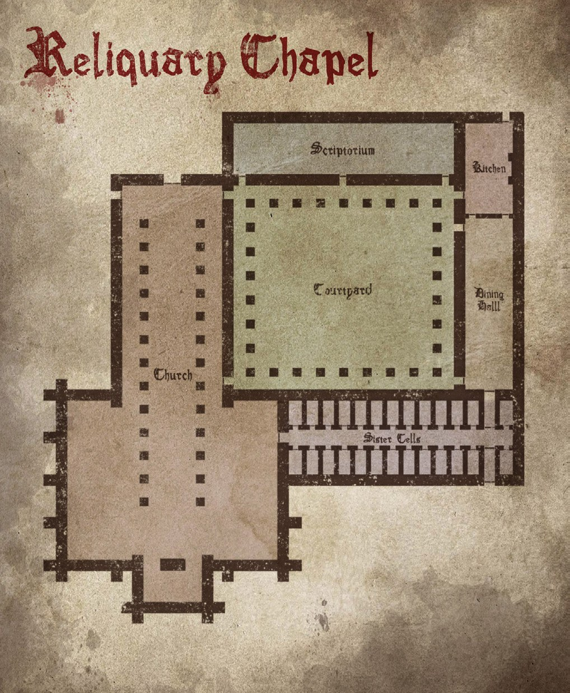

## Акт II

Узнав несколько тревожных подробностей о монастыре Санкта Мария Лактанс, сыщики готовы отправиться туда с визитацией. Здесь им откроется правда об обители — тайна, которая может стоить им жизни.

Монастырь находится в 48 км от Лондона, в графстве Кент, близ замка Хивер. При успешной проверке навыка «Родное королевство (Англия Тюдоров)» сыщик вспомнит, что Хивер — родовой замок семьи будущей королевы Анны Болейн. Сыщики проскачут тёплыми летними днями без происшествий.

### Прибытие в монастырь

Вокруг монастыря Санкта Мария Лактанс раскинулись плодородные поля ячменя, пшеницы, гороха и репы, завещанные ему за минувшие столетия. Успешная проверка Естествознания позволяет заметить, что урожай необычайно крупный, а скот раздался неестественно: животные как будто раздуты.

Крестьяне, работающие в поле, почтительно снимают шапки, когда сыщики проезжают мимо. На вопросы они отвечают односложно. Приглядевшись к ним, можно заметить множество наростов, опухолей и уродств.

Ближе к монастырю поля уступают место густому, тёмному и холодному лесу. Кривые стволы смыкаются над дорогой, словно стены тоннеля. Потом путники выезжают на яркий солнечный свет: монастырь стоит на маленькой поляне среди пёстрых цветов и свежих трав.

Сыщиков встречает мать-настоятельница, сестра Мария. Она уверяет, что ждёт их расспросов с нетерпением: в её доме Божием всё устроено как подобает. При успешной проверке Внимания сыщик замечает, что сестра Мария бросает мимолётный взгляд за плечо, в сторону келий сестёр. Проверка Проницательности покажет, что за спокойствием и собранностью доброй сестры скрывается тревога перед визитацией.

### Что дальше

Теперь сыщики вольны начать расследование. Сестра Мария повсюду их сопровождает, но в остальном не мешает вести расспросы. Ниже — места, которые можно посетить.

> **Примечание хранителю:** Сыщики вполне могут попытаться оторваться от сестры Марии. Та в любой момент может появиться снова и помешать расследованию.

### Граффити

Пока сыщики осматривают монастырь, попросите их пройти проверки Внимания. При успехе они замечают то тут, то там маленькие фигурки, вырезанные на дереве или на штукатурке. Видом они похожи на женщин с козьими копытами и множеством грудей. Если спросить сестру Марию, она сделает вид, что потрясена, скажет, что видит их впервые, и постарается увести сыщиков. Успешная проверка Проницательности покажет, что она знает о граффити и явно не хочет о них говорить.

- Скрипторий.
- Кухня.
- Двор.
- Трапезная.
- Церковь.
- Кельи сестёр.

*Прим. перев.:* План озаглавлен «Часовня-реликварий», но на нём изображён весь монастырь; сама часовня отмечена как «Церковь».

### Часовня-реликварий

Изящная железная решётка преграждает вход в часовню, где хранится святая реликвия Маргариты Лактанс. Вглядываясь сквозь решётку, сыщики видят искусно вырезанный каменный алтарь с реликвией. В часовне положено регулярно служить мессу, а в день святой Маргариты здесь якобы совершается чудо: из груди статуи сочится молоко. Разумеется, это сплошная ложь. Статуя — лишь прикрытие для истинного источника Молока Матери. В часовню никто не заходит, пока сёстры служат своему подлинному призванию.

Если сыщики попросят, сестра Мария впустит их в часовню. Она открывает калитку в решётке, и та громко скрипит. Видно, что её открывают редко, — странно, если вспомнить, как часто здесь полагается служить мессу.

Осматривая статую, сыщики замечают следующее:
