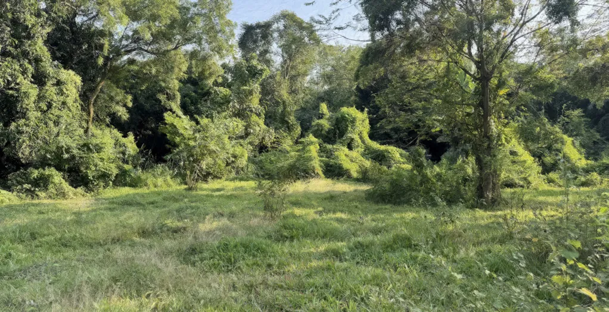

- Статуя вырезана из цельного куска дерева. В ней нет ничего примечательного и никаких признаков чудесных свойств.
- Статуя изображает женщину обычного сложения в одежде, оставляющей открытой только левую грудь.
- Сыщик, осматривающий часовню или статую, при успешной проверке Внимания замечает слой пыли на статуе, полу и алтаре. Должно быть, в часовню давно никто не заходил.

### Скрипторий

В этой тесной, захламлённой и пыльной комнате составляют и хранят монастырские записи. Кроме полок с документами, здесь только письменный стол, заваленный бумагами. Изучив записи и успешно пройдя проверку Работы в библиотеке, сыщик узнаёт следующее:

- По нескольким дарственным земли из владений королевы перешли монастырю.
- Семья Болейн сделала монастырю крупные пожертвования.

Сыщик, который прямо говорит, что разбирает бумаги на столе, или успешно проходит проверку Внимания при осмотре стола, замечает лист промокательной бумаги. Его подложили под другой документ, когда писали. Следы на промокательной бумаге не разобрать, пока их не заштрихуешь угольком. Если это сделать, проступят написанные слова (раздатка 6).

> **Примечание хранителю:** Если игроки не знают, что надпись можно проявить углём, разрешите проверку Идеи, чтобы сыщики догадались об этом способе.

### Кельи сестёр

Вдоль короткого коридора тянутся маленькие кельи. У каждой сестры своя, со скудной обстановкой: койка, стол и таз для умывания. Днём большинство келий пустует, и при обыске сыщики не найдут в них ничего подозрительного. Исключение — запертая келья в дальнем, затенённом конце коридора. Если спросить, сестра Мария объяснит, что монахиня в келье слегла с потливой горячкой, в просторечии «потницей», и её изолировали от остальных. Сыщикам знакома эта болезнь: её вспышки регулярно прокатываются по стране. Чтобы сестра Мария, пусть и крайне неохотно, отперла дверь, нужна успешная проверка Запугивания. Если сыщики ускользнули от матери-настоятельницы Марии, замок можно открыть успешной проверкой Взлома.

В келье трудно что-либо разглядеть: маленькое окно заколочено, и комната в вечном полумраке. Сыщики различают спящую фигуру, которая чуть шевелится при их появлении. Успешная проверка Медицины позволяет заметить, что у сестры нет ни сильного жара, ни липкой кожи, характерных для потливой горячки.

Сыщики не знают, что сестра почти завершила превращение в одного из благословенных сатиров Шуб-Ниггурат. Узнать это можно, только пойдя на крайние меры, например обнажив её тело. Если сыщики позволят себе такую невоспитанность, лежащая в постели сестра-сатир набросится на них, а сестра Мария позовёт других сатиров, чтобы их схватить (см. акт III).

### Поляна

В лесу неподалёку от монастыря скрыта поляна. В полнолуние прислужники собираются здесь на богохульную мессу в честь Шуб-Ниггурат. Вход на поляну скрыт густой порослью; сыщики, обыскивающие окрестности, могут наткнуться на него при успешной проверке Внимания.

При входе на поляну нужна проверка Рассудка (потеря 0/1). При успехе становится слегка не по себе. При провале сыщика охватывает сильное чувство, что здесь произошло что-то нечестивое. Каков бы ни был результат, внимание сыщиков привлекает одно дерево. Это самое высокое дерево на поляне; оно слегка покачивается даже в безветрие. Если осмотреть его вблизи, на стволе видны потёки сока из двух опухолевидных наростов.

Перед высоким деревом растут пять тонких буков. Если осмотреть их и успешно пройти проверку Внимания, на земле найдётся лоскуток, словно оторванный от платья. При трудном успехе заметно также, что у подножия каждого бука земля истоптана со стороны большого дерева.

*Прим. перев.:* В тексте пять буков, на плане на с. 105 — четыре дерева для жертв.
