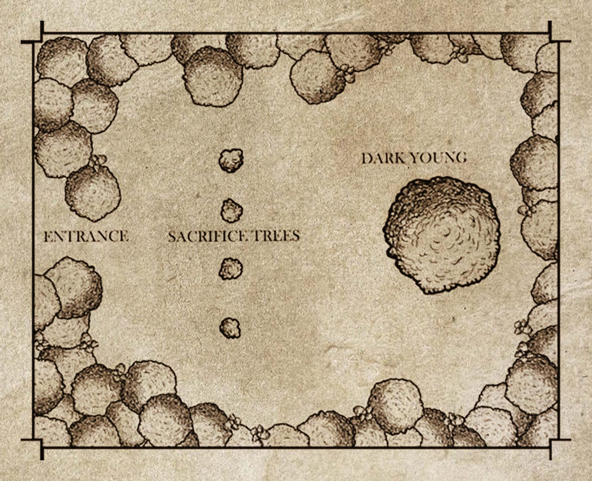

## Акт III

Когда сыщики осмотрят монастырь и удовлетворят любопытство, им покажут приготовленные для них комнаты. Теперь они вольны делать что им заблагорассудится. Культ же не намерен выпускать их из обители: этой ночью сыщиков хотят принести в жертву тёмному божеству.

Посреди ночи, где бы ни находились сыщики, разрешите каждому пройти проверку Слуха. При успехе сыщик слышит, как где-то скрипит дверь, а за ней тихо цокают копыта. Это идут сёстры, которых молоко Шуб-Ниггурат превратило в сатиров. Под началом сестры Марии козлоногие твари разыскивают сыщиков и набрасываются на них со звериной яростью. Сатиров вдвое больше, чем сыщиков, и едва ли их удастся одолеть силой. После первого раунда боя сестра Мария приказывает брать сыщиков живыми. Сатиры пытаются схватить и обездвижить их либо лишить сознания. Если кому-то удастся улизнуть, перед ним встанет нелёгкий выбор: спасать собственную шкуру или вернуться за пленными товарищами.

### Церемония

Каждого пленённого сыщика привязывают к одному из небольших деревьев перед громадным кривым старым деревом. От него слегка тянет гнилью и кислым молоком (см. «Поляна»). К другому дереву привязана ещё одна жертва — деревенский мальчик, который тщетно бьётся в путах и зовёт маму. Вокруг рощи собрались члены культа. Судя по богатому платью, среди них немало состоятельных дам и господ. Все, кроме сестёр, ведущих обряд, прячут лица под звериными масками — уродливыми подобиями коз, овец и оленей.

- Вход.
- Деревья для жертв.
- Тёмная молодь.

Культисты по очереди подходят к большому дереву и предстают в своём подлинном облике, показывая собравшимся свои изменения. При каждом новом откровении собрание поёт: «Мать лесов, мать тысячи младых, приносим Тебе тела, да установишь Ты царство Своё на земле, как на небе». Тем временем сатиры скачут по поляне в исступлённом предвкушении.

Сыщики видят козьи черты и мохнатые отростки, лишние конечности и половые органы. Хранителю стоит описывать эти уродства настолько подробно, насколько уместно для его группы. На одном знаке следует остановиться особо. Богато одетая дама с распущенными волосами цвета воронова крыла показывает своё благословение: лишний палец на каждой руке. Это сыграет свою роль в эпилоге.

Когда остальные покажут свои изменения, сестра Мария встаёт перед деревом и обнажается. У неё множество грудей, похожих на козье вымя. Из каждого соска на обнажённую грудь течёт бледная вязкая жидкость. Культисты подходят и припадают к её груди, порой вдвоём или по нескольку человек сразу. Собрание поёт: «Молоко Твоё благословенное дай нам днесь и ниспошли нам благословение Твоё».

В кульминационный миг сестра Мария сцеживает остатки молока в резную деревянную чашу и передаёт её одному из прислужников. Молоком крестят каждого сыщика и мальчика, привязанного к буку. Как только всех окрестят, великое старое дерево изгибается и корчится, оживая и обретая свой подлинный облик — Тёмной молоди Шуб-Ниггурат. Из ствола прорываются пульсирующие отростки, похожие на щупальца. Один слизистый, вздрагивающий хобот шарит по земле в сторону привязанных жертв, начиная с мальчика.

Извивающийся отросток достигнет первой жертвы за один раунд. Если ему не помешать, он скользнёт выше, пронзит жертву, а в следующем раунде высосет из неё жизнь. В каждом последующем раунде он перебирается к новой жертве, и всё повторяется.

### Верная смерть

Даже во время церемонии сыщики, скорее всего, отчаянно пытаются освободиться. Дайте каждому по две попытки высвободиться из пут: в начале церемонии и когда сестра Мария обнажается. Чтобы вырваться из лоз, связывающих руки, нужна трудная проверка СИЛ или
