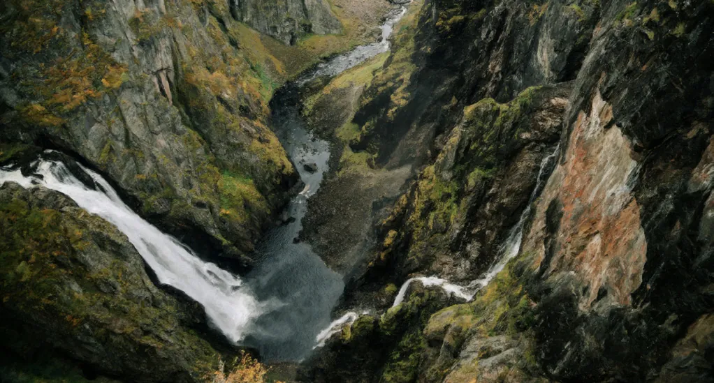

ЛВК. При обычном успехе сыщик ещё не освобождается, но получает бонусную кость ко всем дальнейшим попыткам.

Сыщики, догадавшиеся спрятать при себе нож или другой острый предмет, могут попытаться перерезать путы, пройдя проверку Ловкости рук. Другой вариант — дать каждому проверку Удачи. При успехе сыщик находит у себя что-нибудь острое, чем можно освободиться.

Сыщики могут обратиться к культистам. Если сыщик упомянет Молоко, Мать или её младых и успешно пройдёт проверку Убеждения, сестра Мария остановится и заговорит с ним. Она спросит, желает ли он добровольно отдаться Матери и принять её благословение. Если сыщик согласится, его отвяжут, а сестра Мария предложит ему вкусить молока из её груди. Получив молочное благословение, сыщик волен попытаться спасти товарищей или смотреть, как они гибнут.

Неважно, освободился сыщик сам или его отпустила мать-настоятельница: чтобы освободить одного товарища, ему нужен один раунд. К счастью, культисты охвачены обрядовым восторгом и ничего не замечают, пока не отвязан последний живой сыщик. Тут они понимают, что произошло, и на поляне начинается суматоха. Сыщикам остаётся бежать, спасая жизнь. Каждый должен один раунд продержаться против одного сатира или культиста, прежде чем сможет оторваться.

Если сыщик вместо этого успешно атакует шарящий отросток Тёмной молоди, тот втянется в дерево, сочась молочной жидкостью, и не сможет забрать очередную жертву в следующем раунде. Тёмная молодь разразится воем, визгом и пронзительным плачем. Шум мгновенно выводит культистов из экстаза: они ошеломлены нападением на божество. Этого замешательства хватит, чтобы сыщики ушли в лес, прежде чем культ опомнится и бросится в погоню.

Если сыщики решат не бежать, противник будет иметь большой перевес: на каждого сыщика придётся не менее двух сатиров и одного культиста. К счастью, Тёмная молодь приросла к этому месту и ничего не предпринимает, пока на неё не нападут. Если сыщики всё же справятся, они могут напасть на сестру Марию. Если она погибнет, остальные культисты, в том числе сатиры, потеряют решимость и разбегутся.

### Погоня

Когда сыщики доберутся до леса, культисты уже опомнятся и бросятся следом.

Чтобы уйти от погони, сыщикам нужно преодолеть следующие препятствия:

- **Колючие заросли ежевики, словно проволока.** Чтобы не запутаться, нужна успешная проверка ЛВК. При провале сыщик теряет один раунд, за который на него нападает культист. В следующем раунде для освобождения нужна успешная проверка СИЛ. Нож, меч или другое клинковое оружие дают автоматический успех.
- **Корни.** Чтобы не подвернуть лодыжку на корнях, нужна успешная проверка ЛВК. Подвернувший ногу получает штрафную кость ко всем проверкам навыков или характеристик, связанным с движением, например Уклонения или Драки.
- **Засада.** Сатир нападает и пытается схватить сыщика. Если сыщик ранит его, сатир отступает под защиту леса. При успешной проверке Уклонения сыщик тоже может продолжить бегство. Иначе каждые 1d3 раунда к схватке присоединяется ещё один сатир или культист.

Выскочив из леса, сыщики едва успевают остановиться на краю оврага. Внизу вьётся река. Овраг отрезал им путь, так что выбор невелик: прыгать или драться. Если они выберут бой, каждый раунд будет прибегать по одному сатиру или культисту.

Прыгающий в овраг должен успешно пройти проверку Прыжков. При провале он получает 2d6 урона; если от падения он потеряет сознание, то утонет, если другой сыщик не поможет. Оказавшись в реке, сыщик в сознании должен пройти проверку Плавания, чтобы не утонуть. Поддерживая товарища без сознания, он получает к этой проверке штрафную кость (см. с. 124 «Книги хранителя»).

Тех, кто переживёт падение и не утонет, унесёт течением. В конце концов их прибьёт к берегу — потрёпанных, но живых и свободных от культа.
