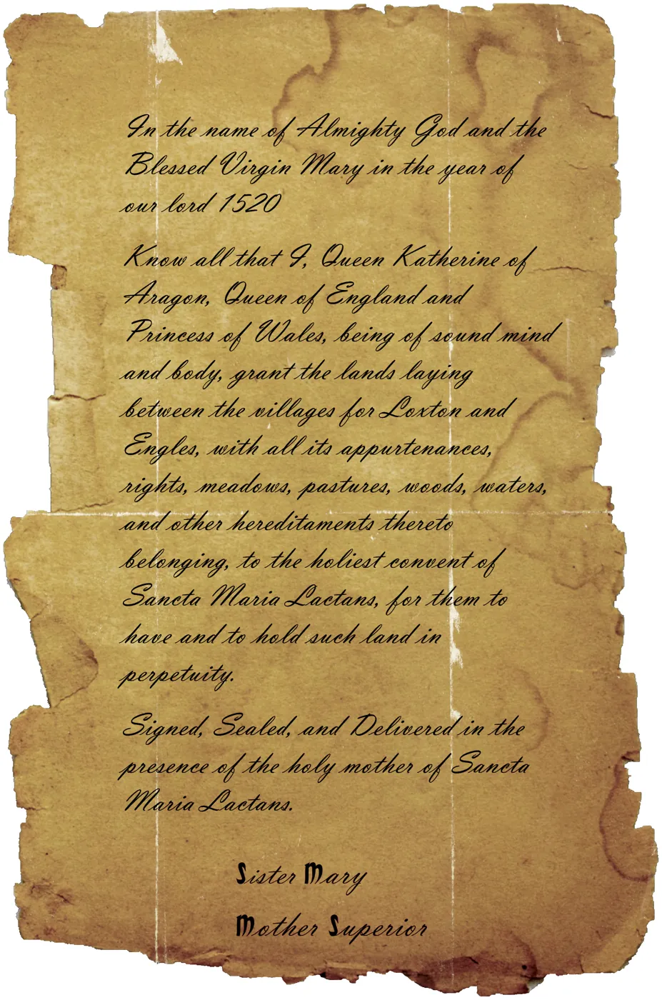

## Раздатки для игроков

> **Раздатка 1. Дарственная королевы Екатерины (1520)**
>
> Во имя Всемогущего Бога и Пресвятой Девы Марии, в год Господа нашего 1520.
>
> Да будет ведомо всем, что я, королева Екатерина Арагонская, королева Англии и принцесса Уэльская, будучи в здравом уме и теле, жалую земли, лежащие между деревнями Локстон и Энглс, со всеми их принадлежностями, правами, лугами, пастбищами, лесами, водами и прочими наследуемыми владениями, к ним относящимися, святейшей обители Санкта Мария Лактанс, дабы владела она сими землями вечно.
>
> Подписано, скреплено печатью и вручено в присутствии святой матери Санкта Мария Лактанс.
>
> Сестра Мария
>
> Мать-настоятельница

*Прим. перев.:* В оригинале стоит «villages for Loxton» вместо «villages of Loxton»; в тексте восстановлен смысл.
