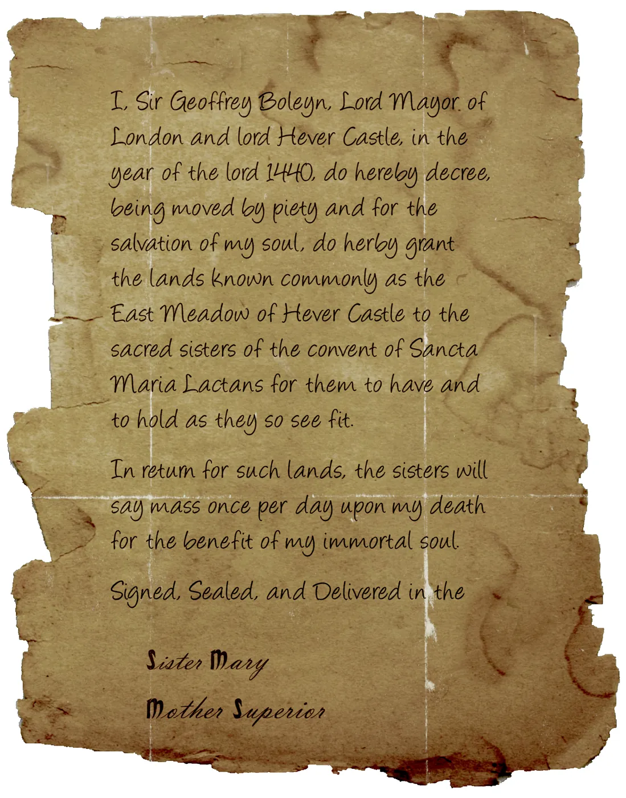

<!-- -->

> **Раздатка 2. Дарственная сэра Джеффри Болейна (1440)**
>
> Я, сэр Джеффри Болейн, лорд-мэр Лондона и владетель замка Хивер, в год Господень 1440 сим постановляю, движимый благочестием и ради спасения души моей, жаловать земли, обычно именуемые Восточным лугом замка Хивер, святым сёстрам обители Санкта Мария Лактанс, дабы владели и распоряжались ими, как сочтут нужным.
>
> Взамен сих земель сёстры будут служить мессу единожды в день по моей смерти ради блага бессмертной души моей.
>
> Подписано, скреплено печатью и вручено в
>
> Сестра Мария
>
> Мать-настоятельница

*Прим. перев.:* Формула «Подписано, скреплено печатью и вручено в» обрывается и в оригинале. В английском тексте также напечатано «do herby grant» вместо «do hereby grant».
