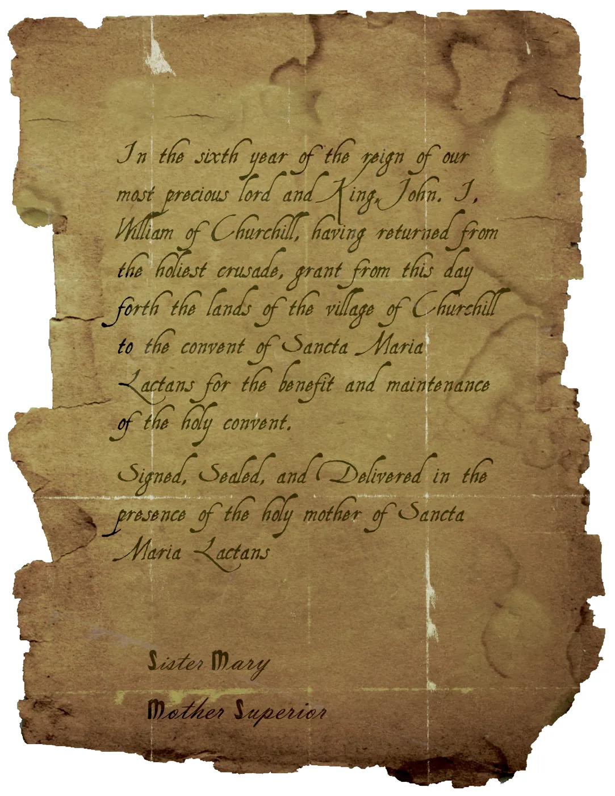

<!-- -->

> **Раздатка 3. Дарственная Уильяма из Черчилля**
>
> В шестой год правления нашего драгоценнейшего господина и короля Иоанна. Я, Уильям из Черчилля, вернувшись из святейшего крестового похода, жалую отныне земли деревни Черчилль обители Санкта Мария Лактанс на благо и содержание святой обители.
>
> Подписано, скреплено печатью и вручено в присутствии святой матери Санкта Мария Лактанс
>
> Сестра Мария
>
> Мать-настоятельница
