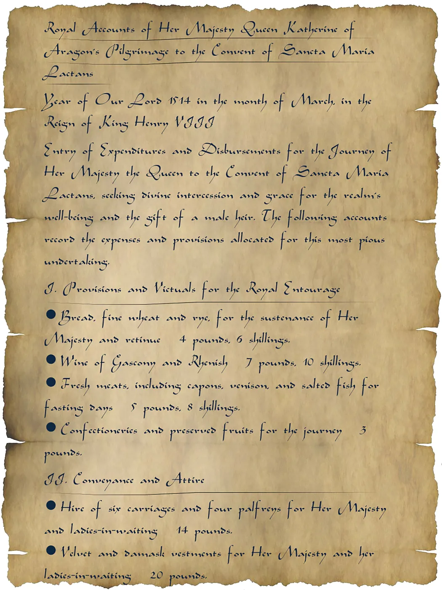

<!-- -->

> **Раздатка 4a. Счета паломничества королевы (1514) — первый лист**
>
> Королевские счета паломничества Её Величества королевы Екатерины Арагонской в обитель Санкта Мария Лактанс
>
> Год Господа нашего 1514, месяц март, в правление короля Генриха VIII
>
> Запись расходов и выплат на путешествие Её Величества королевы в обитель Санкта Мария Лактанс ради божественного заступничества и благодати для благополучия королевства и дара наследника мужского пола. Нижеследующие счета записывают расходы и припасы, выделенные на сие благочестивейшее предприятие.
>
> I. Провизия и съестное для королевской свиты
>
> • Хлеб, тонкий пшеничный и ржаной, на пропитание Её Величества и свиты — 4 фунта 6 шиллингов.
>
> • Вино гасконское и рейнское — 7 фунтов 10 шиллингов.
>
> • Свежее мясо, в том числе каплуны и оленина, и солёная рыба на постные дни — 5 фунтов 8 шиллингов.
>
> • Сласти и засахаренные фрукты в дорогу — 3 фунта.
>
> II. Перевозка и платье
>
> • Наём шести карет и четырёх иноходцев для Её Величества и фрейлин — 14 фунтов.
>
> • Бархатные и камчатные одеяния для Её Величества и её фрейлин — 20 фунтов.
