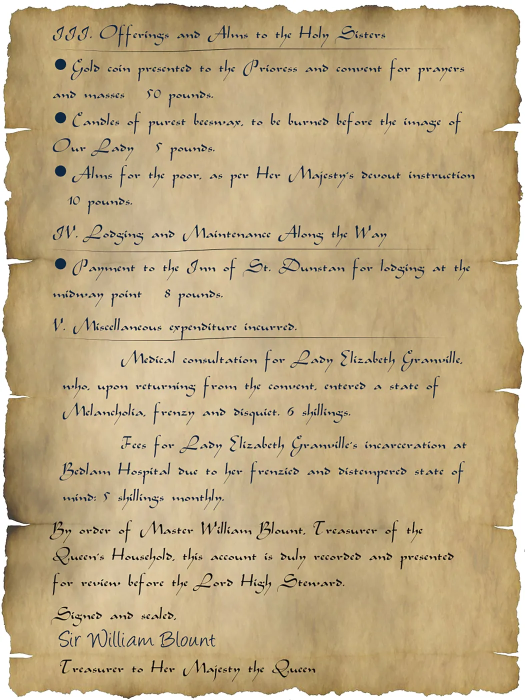

<!-- -->

> **Раздатка 4b. Счета паломничества королевы (1514) — второй лист**
>
> III. Приношения и милостыня святым сёстрам
>
> • Золотая монета, поднесённая настоятельнице и обители за молитвы и мессы, — 50 фунтов.
>
> • Свечи чистейшего пчелиного воска, дабы горели пред образом Богоматери, — 5 фунтов.
>
> • Милостыня бедным по благочестивому указанию Её Величества — 10 фунтов.
>
> IV. Ночлег и содержание в пути
>
> • Плата постоялому двору Святого Дунстана за ночлег на полпути — 8 фунтов.
>
> V. Прочие понесённые расходы
>
> Лекарская консультация для леди Элизабет Гранвиль, которая по возвращении из обители впала в состояние меланхолии, неистовства и смятения, — 6 шиллингов.
>
> Плата за содержание леди Элизабет Гранвиль в Бедламе по причине её неистового и расстроенного состояния ума — 5 шиллингов в месяц.
>
> По приказу мастера Уильяма Блаунта, казначея двора королевы, сей счёт надлежаще записан и представлен на рассмотрение лорду-стюарду.
>
> Подписано и скреплено печатью.
>
> Сэр Уильям Блаунт
>
> Казначей Её Величества королевы
