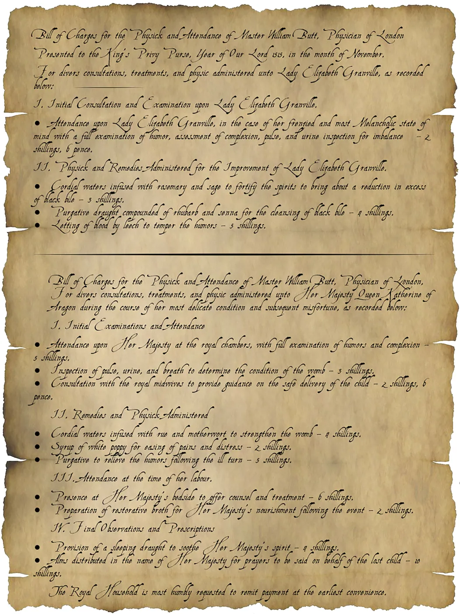

<!-- -->

> **Раздатка 5. Счета доктора Уильяма Баттса**
>
> Счёт за врачевание и посещения мастера Уильяма Батта, лондонского врача
>
> Представлен в личную казну короля, год Господа нашего 1515, месяц ноябрь.
>
> За разные консультации, лечение и снадобья, предоставленные леди Элизабет Гранвиль, как записано ниже:
>
> I. Первичная консультация и осмотр леди Элизабет Гранвиль.
>
> • Посещение леди Элизабет Гранвиль по поводу её неистового и весьма меланхолического состояния ума, с полным осмотром гуморов, оценкой цвета лица, пульса и исследованием мочи на предмет нарушения равновесия — 2 шиллинга 6 пенсов.
>
> II. Снадобья и средства, применённые для улучшения состояния леди Элизабет Гранвиль.
>
> • Укрепляющие воды, настоянные на розмарине и шалфее, дабы подкрепить дух и уменьшить избыток чёрной желчи, — 3 шиллинга.
>
> • Слабительное питьё из ревеня и сенны для очищения от чёрной желчи — 4 шиллинга.
>
> • Кровопускание пиявками, дабы умерить гуморы, — 5 шиллингов.
>
> 
>
> Счёт за врачевание и посещения мастера Уильяма Батта, лондонского врача,
>
> за разные консультации, лечение и снадобья, предоставленные Её Величеству королеве Екатерине Арагонской во время её весьма деликатного положения и последовавшего несчастья, как записано ниже:
>
> I. Первичные осмотры и посещения
>
> • Посещение Её Величества в королевских покоях с полным осмотром гуморов и цвета лица — 5 шиллингов.
>
> • Исследование пульса, мочи и дыхания для определения состояния чрева — 3 шиллинга.
>
> • Консультация с королевскими повитухами о благополучном разрешении от бремени — 2 шиллинга 6 пенсов.
>
> II. Применённые средства и снадобья
>
> • Укрепляющие воды, настоянные на руте и пустырнике, для укрепления чрева — 4 шиллинга.
>
> • Сироп белого мака для облегчения болей и страданий — 2 шиллинга.
>
> • Слабительное для облегчения гуморов после дурного оборота — 5 шиллингов.
>
> III. Присутствие во время родов.
>
> • Присутствие у ложа Её Величества для совета и лечения — 6 шиллингов.
>
> • Приготовление укрепляющего бульона для питания Её Величества после случившегося — 2 шиллинга.
>
> IV. Заключительные наблюдения и предписания
>
> • Сонное питьё, дабы успокоить дух Её Величества, — 4 шиллинга.
>
> • Милостыня, розданная от имени Её Величества за молитвы о потерянном дитяти, — 10 шиллингов.
>
> Королевский двор покорнейше просят уплатить при первой возможности.

*Прим. перев.:* В раздатке врач назван мастером Уильямом Баттом (Master William Butt), тогда как в тексте сценария он доктор Уильям Баттс. Первый счёт датирован ноябрём 1515 года.
