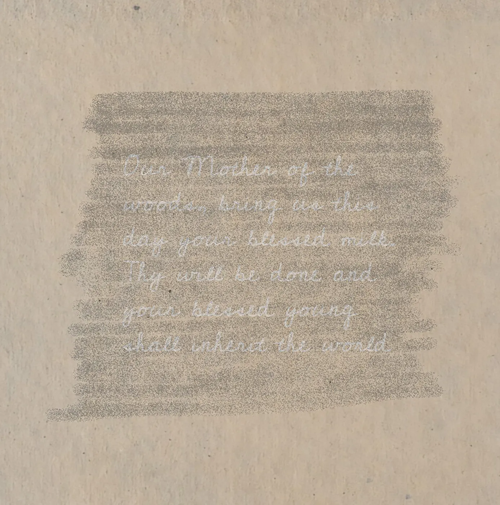

<!-- -->

> **Раздатка 6. Промокательная бумага**
>
> Мать наша лесная, даждь нам днесь благословенное молоко твоё. Да будет воля твоя, и благословенные младые твои наследуют мир.

> **Примечание хранителю:** При игре за одним столом можно распечатать раздатку. Подложите под неё ещё один лист бумаги и обведите буквы пустым стержнем шариковой ручки. Игроки смогут натереть лист с продавленными буквами восковым мелком или мелом и прочесть записку.
