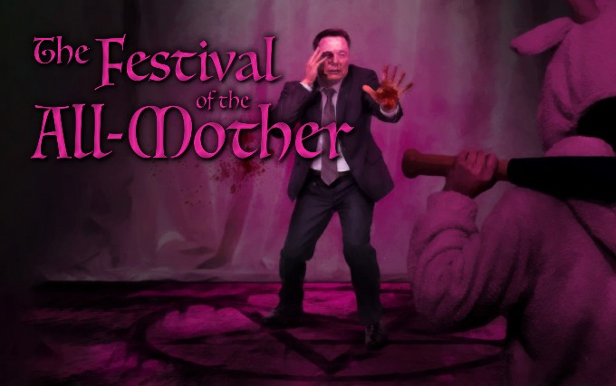

# Фестиваль Всематери

*Современный сценарий для «Зова Ктулху» от Ольги Патейн*  
**Сыщики:** 3–5 • **Время игры:** 3–4 часа

## Вступление

Древние боги осваивают соцсети! Последователи Шуб-Ниггурат, Чёрной Козы Чащоб с Легионом Младых, основали культ инфлюенсеров, проповедующих здоровый образ жизни. Под пастельной вывеской показного феминизма «Культ Всематери» продвигает сверхплодовитость, женскую ярость и сексуальное господство над мужчинами. Алгоритмы ему нипочём, а девочки-подростки подписываются толпами.

Каждый год культ устраивает фестиваль и на извращённом языческом конкурсе коронует новую Божественную Дочь, выбирая её из числа талантливых девочек-подростков. Победительница мигом взлетает в соцсетях и становится пророчицей для сверстниц.

Игрокам достаются роли встревоженных родителей четырёх девочек-подростков, которые собираются на фестиваль любимых инфлюенсеров. Родители договариваются присматривать за дочерьми на фестивале, но те ускользают при первой же возможности.

Чем безумнее становится фестиваль, тем труднее родителям разобраться в себе, в отношениях друг с другом и с дочерьми. В финале они либо останавливают коронацию принцессы фестиваля, либо терпят неудачу.

Пугает здесь прежде всего то, что знакомое становится жутким, а обычное общение — мучительно неловким. В основе сценария лежит знакомая всем ситуация: подростки хотят свободы, а родители хотят защитить их от всего на свете.

При этом сыщикам предстоит столкнуться с собственными сокровенными, тёмными мечтами и желаниями на глазах у лучших друзей и партнёров, в том числе бывших. Угроз телу немного, но ужас и опасность вполне реальны.

### Структура сценария

В **акте I** сыщики, встревоженные родители, встречаются, чтобы обсудить свои опасения насчёт Всематери и её инфлюенсеров. В **акте II** сыщики приезжают на фестиваль вместе с дочерьми, но девочки исчезают, а родители с трудом пробиваются внутрь. В **акте III** сыщики уже на фестивале и обходят павильоны в поисках детей. В **акте IV**, в зависимости от действий сыщиков, новую Божественную Дочь либо коронуют, либо нет.
