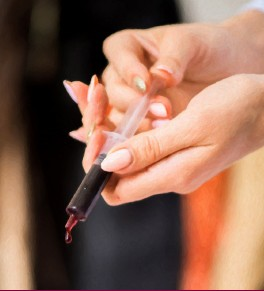

### Досмотр сумок

Как и на любом фестивале, у посетителей, в том числе сыщиков, досматривают сумки. Проносить еду, напитки, оружие и наркотики запрещено: предложите игрокам проверить личные вещи персонажей. Например, если с ними Синди Хуан, у неё при себе кокаин. Сумки проверяет охранный отряд Старших Сестёр — приветливые, но грозные крепкие женщины с длинными пастушьими посохами для защиты милой паствы внутри. Своевременная встречная проверка **Ловкости рук** против **Внимания** отряда (40%) позволяет пронести что угодно. У пойманных сыщиков отберут запрещённое и прочтут им снисходительную лекцию о здоровье и безопасности.

### Медпункт

Если сыщики решат вместо оплаты сдать кровь, к ним подходит молодая женщина в форме медсестры и с повязкой на глазу. «Вам нож или шприц?» — весело спрашивает она и берёт шприц, хотя сыщики могут заметить, что нож лежит рядом. Медсестра заверяет сыщика, что он храбрый мальчик или храбрая девочка, и начинает считать с трёх, но колет уже на «два». Чтобы не захныкать в знак протеста, нужна успешная проверка **МОЩ**. Кровь собирают в золотую чашу с изображением козы. На вопрос, для какого медицинского исследования нужна кровь, медсестра отвечает: для изучения фертильности. Проверка **Медицины** подскажет, что это вряд ли правда, но сыщик, скорее всего, и сам это понимает.

## Акт III. Поиски девочек

Простояв больше часа под палящим солнцем, сыщики наконец попадают внутрь. На входе им дают **раздатку 2. Карту фестиваля**, на которой отмечено несколько интересных мест. Но в толпе из тысяч одинаково одетых девочек-подростков их дочерей нигде не видно. Многие нарядились козочками в пастельных тонах, один костюм причудливее другого. Некоторые даже водят молодых мужчин на поводках. На светодиодных экранах мелькают вдохновляющие цитаты, в воздухе стоит приторный запах переспелых фруктов и козьего молока. От прилавков так и веет агрессивной заботой о здоровье. «Натуральные витаминные шоты без токсинов» и мыло с пчелиным воском рекламируют бок о бок с ярко-розовыми штанами для йоги.

До конца **акта III** сыщики ищут дочерей, обходя отмеченные на карте места. В нужном месте они найдут одну из девочек, но, чтобы увести её, придётся преодолеть препятствие. Вот основные места и кого в них можно встретить:

- **Бар сырого молока:** полезный источник информации, но девочек здесь нет.
- **Центр усыновления козлят:** Лиза Теллерманн настаивала, что хочет усыновить козлёнка; её можно найти здесь.
- **Клетка ярости:** сыщики становятся свидетелями жестокой сцены, в которой участвует Мэри Митчеллс.
- **Колодец желаний:** дочерей нет, зато можно встретить одну из инфлюенсерок Всематери.
- **Зеркальный лабиринт:** здесь можно найти Беллу Теллерманн посреди острого душевного кризиса.
- **Главная сцена:** пустует до **акта IV**, когда Шарлот Хуан вступит в смертельную схватку с другой девочкой за право стать принцессой фестиваля.

*Прим. перев.:* в пункте о Клетке ярости в оригинале «Мэри Митчелл», а в листах её родителей фамилия — «Митчеллс».

Лучше всего, если в каждой сцене будет присутствовать хотя бы один из родителей девочки: это даст повод для отыгрыша.
