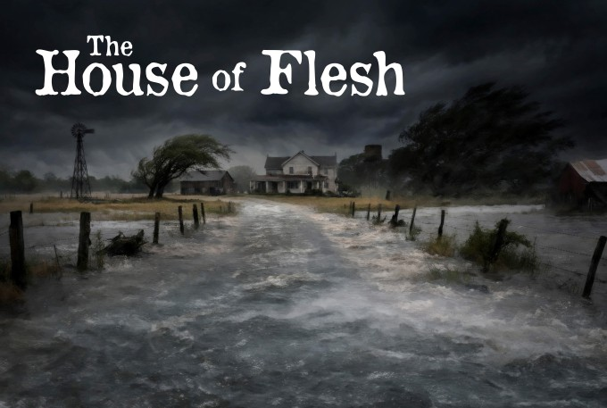

# Дом плоти

*Современный сценарий для «Зова Ктулху» от Антонио Марчены*  
**Сыщики:** 4 • **Время игры:** 3–4 часа

*Прим. перев.:* в английском подзаголовке пропущено `of` в названии игры.

## Вступление

В «Доме плоти» компания друзей бежит от разрушительного урагана и разбивает машину в глухом затопленном лесу. Они укрываются в ближайшем доме, не подозревая, что он принадлежит Торнам, семье людоедов, поклоняющихся Шуб-Ниггурат. Смогут ли сыщики пережить ужасы, скрытые в Доме плоти?

Сценарий раскрывает три стороны Чёрной Козы Чащоб: преображающую силу Шуб-Ниггурат, превращающую живых существ в чудовищ; колдовство Торнов, чьи тайные обряды породили чудовищный аватар; и извращённый способ, которым женщины Торн продолжают свой род, — людоедство и тёмные ритуалы.

Главный источник вдохновения для «Дома плоти» — классический фильм ужасов 1974 года «Техасская резня бензопилой». Здесь много телесного ужаса, крови и гнетущего страха. Сценарий рассчитан на хранителей и игроков любого уровня опыта. Готовых сыщиков шестеро, хотя сценарий задуман для четырёх игроков. Два запасных персонажа могут заменить погибших или стать дополнительными жертвами.

### Структура сценария

В начале сценария машина сыщиков разбивается во время урагана. Очнувшись, они обнаруживают, что вокруг тихо, и понимают: они в глазу урагана. Один или несколько сыщиков ранены; им отчаянно нужно укрытие. Звук работающего генератора приводит их на ферму Торнов.

Дом Торнов кажется пустым, двери не заперты, и сыщики могут осмотреться. Вскоре они понимают, что здесь что-то не так. Из морозильника в комнате Сэмюэла Торна доносится голос девушки по имени Пэм: она пытается выбраться.

*Прим. перев.:* здесь — морозильник; в описании комнаты Сэмюэла на с. 142–143 — термоящик со льдом.

Пока сыщики осматриваются, женщина по имени
