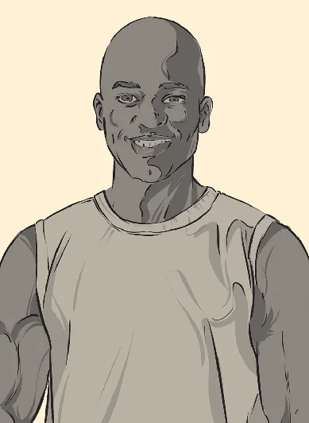
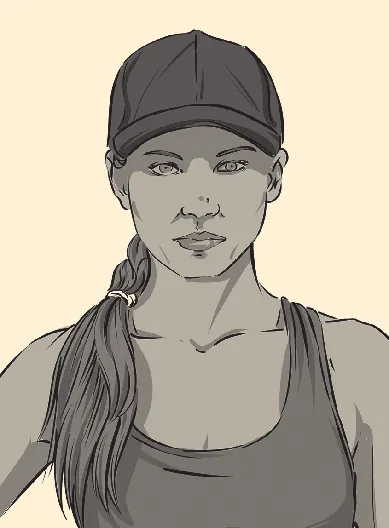

Салли входит с заднего крыльца. Она приторно любезна, предлагает помочь раненым и пытается разделить компанию. Когда это удаётся, она пускает в ход магию против оставшихся с ней, а её чудовищный, обезображенный внук Сэмюэл нападает на остальных.

В конце концов — либо попав в плен, либо раскрыв планы Торнов — сыщики оказываются в большом красном амбаре, где идёт ритуал, связанный с ураганом. Там они находят ещё живого Франклина, жениха Пэм, подвешенного на мясном крюке. Там же они видят Сару, дочь Салли и мать Сэмюэла, превратившуюся в аватар Шуб-Ниггурат. Салли заканчивает обряд, который приведёт Магна Матер (Шуб-Ниггурат) в наш мир. Сыщикам остаётся либо сорвать ритуал, либо бежать, пусть даже спасение окажется временным.

## Предыстория

### Семья Торн

Семьёй Торн правят матриархи. Уже много веков они тайно поклоняются Шуб-Ниггурат в облике Магна Матер, или Великой Матери, и совершают кровавые обряды с человеческими жертвоприношениями.

Семью сегодня возглавляет Салли Торн. Она умна, осторожна и опасна. Чтобы скрыть тёмные тайны семьи и не выделяться, она вышла за богатого фермера Дэвида Кэмпбелла и родила от него дочь Сару. Салли, когда муж перестал быть нужен, заклинанием вызвала у него сердечный приступ, чтобы смерть выглядела естественной. Она всецело предана культу и передаёт его знания дочери, чтобы он не угас.

Сара — единственная дочь Салли. В юности она забеременела от жестокого партнёра, после чего её поразил паралич. Мужчину принесли в жертву Шуб-Ниггурат, и та благословила Сару, сделав её сосудом, через который тёмная богиня семьи может говорить и действовать.

Когда Сара родила Сэмюэла, он появился на свет с уродствами: Магна Матер коснулась его ещё в утробе. Мальчик рос быстро и набрал невероятную силу. Он стал незаменим для семьи: её охотником и карателем, добывающим жертв для ритуалов и защищающим парализованную мать.

### Ураган «Гуннар»

Никто не догадывается, что ураган пятой категории, разоряющий побережье Южного Техаса, — часть ритуала семьи Торн. Как только глаз бури окажется в нужной точке над фермой, Торны намерены открыть портал и впустить Магна Матер в этот мир.

## О сыщиках

Когда ураган «Гуннар» обрушивается на Южный Техас, жителей городов эвакуируют. Сыщики — молодые друзья, живущие в одном жилом комплексе в Хьюстоне. Им приходится спешно бежать от чудовищной бури.

### Данте Кольер, 24 года

*Боксёр («Качок»).*

Данте — профессиональный боксёр, привыкший держать удар. Он вырос в неблагополучном районе и начал боксировать, чтобы защитить себя и вырваться из прежней жизни. С остальными он познакомился на районном барбекю и покорил их обаянием и историями. Он живёт с лучшим другом Стивеном, но это может измениться, если у них с Аннабель всё станет серьёзно. Данте высокий, сильный; от боёв у него осталось несколько шрамов. Строит из себя крутого, но по-настоящему дорожит друзьями и старается их защищать.

**Черты:** решительный, заботливый, общительный; любит внимание.

**Зацепки для отыгрыша:** отношения с Аннабель могут раскрыть его мягкую сторону или вызвать ревность. Ради защиты друзей он пойдёт на всё, даже если сам окажется в опасности.

### Джойс Бриггс, 23 года

*Мастер на все руки («Скептик»).*

Джойс умеет чинить практически всё. Её отец был механиком, и она пошла по его стопам. Если у кого-то в жилом комплексе что-нибудь ломается, звонят ей. Свои каштановые волосы она собирает в хвост под потёртой кепкой, одевается просто и практично. Джойс спокойна и собранна даже в напряжённой обстановке. Помогает Данте тренироваться. Особенно хорошо ладит со Стивеном: оба любят истории. И, кажется, начинает питать к молодому писателю более нежные чувства.

**Черты:** сохраняет самообладание под давлением, умелая, спортивная и серьёзная.

**Зацепки для отыгрыша:** когда всё идёт наперекосяк, её навыки помогают друзьям не растеряться. Дружба со Стивеном может перерасти во что-то большее.
