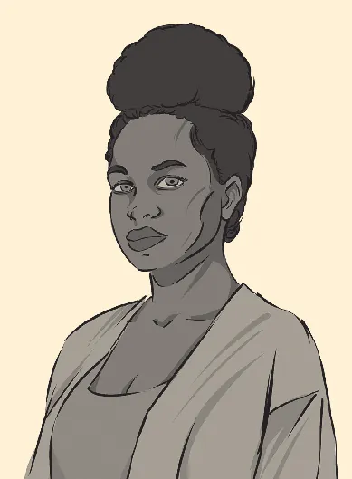
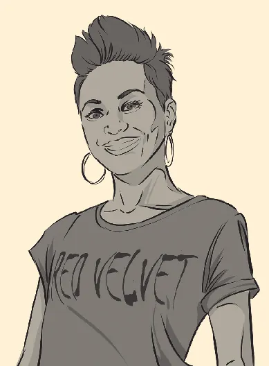

### Бренда Кирби, 21 год

*Горничная («Верующая»).*

Бренда работает горничной в том же доме, где живёт. Благодаря религиозному воспитанию она добра к людям. Она тихая, трудолюбивая и всегда старается изо всех сил. Бренда перебралась в Хьюстон из маленького городка, чтобы помогать семье. Теперь без неё не представить всю компанию. Со Стивеном её сближает любовь к историям: он пишет, а она рисует наброски. В последнее время Бренда сблизилась с Челси, и дружба переросла в любовь. Они съехались в прошлом мае. Бренда обычно собирает тёмные волосы в пучок и одевается скромно.

**Черты:** трудолюбивая, внимательная, вдумчивая и заботливая; глубоко верующая.

**Зацепки для отыгрыша:** её зоркий глаз может уловить то, что пропустили другие. Бренда верит тихо и искренне и хочет, чтобы их отношения с Челси стали крепче.

### Аннабель Фуэнтес, 24 года

*Бармен («Душа компании»).*

Аннабель — дружелюбная барменша с лёгким характером. Она переехала из Далласа в Хьюстон, чтобы начать с чистого листа подальше от чересчур опекающих родителей. Когда кому-то надо выговориться, идут к ней. Их отношения с Данте крепнут, а ночные разговоры утешают обоих. Обычно она носит джинсы и футболки. У неё короткие светлые волосы и лучезарная улыбка.

**Черты:** дружелюбная, отзывчивая и энергичная, с ней легко говорить.

**Зацепки для отыгрыша:** она часто помогает другим справиться с проблемами, но из-за этого может оказаться в самом центре ссоры, особенно если под угрозой её отношения с Данте.

### Стивен Герберт, 22 года

*Писатель («Ботаник»).*

Стивен мечтает прославиться как автор ужасов. Ради этой мечты он переехал в Хьюстон и теперь записывает мрачные истории в маленькую тетрадь, которую всегда носит с собой. Самостоятельное издание принесло ему некоторый успех; он вечно работает над новым рассказом. Живёт с Данте, но, если у того с Аннабель всё станет серьёзнее, возможно, придётся съехать. Стивен вдумчив и изобретателен, и любовь к историям сблизила его с Брендой. Ещё он начинает влюбляться в Джойс: она восхищает его силой и умением.

**Черты:** наблюдательный, с богатым воображением; производит впечатление человека, который много думает.

**Зацепки для отыгрыша:** его чувства к Джойс могут окрепнуть, а знание страшных историй поможет компании разобраться в странных и пугающих ситуациях.

### Челси Уорд, 23 года

*Студентка сестринского дела («Невинная»).*

Челси учится на медсестру, и у неё большое сердце. Она переехала в Хьюстон на учёбу, быстро сдружилась с остальными, и теперь все могут на неё положиться. Она близка с Джойс, а теперь они с Брендой влюбляются друг в друга. Аннабель она доверяет, и та стала подругой, которой можно поверить секреты. Челси улыбается даже в тяжёлые времена. Её легко узнать по рыжим кудрям, веснушкам и очкам в золотистой оправе.

**Черты:** заботливая, умная и жизнерадостная, всегда готова помочь.

**Зацепки для отыгрыша:** в ураган её медицинские навыки могут пригодиться, а отношения с Брендой могут заставить её решать, кому помочь в первую очередь.
