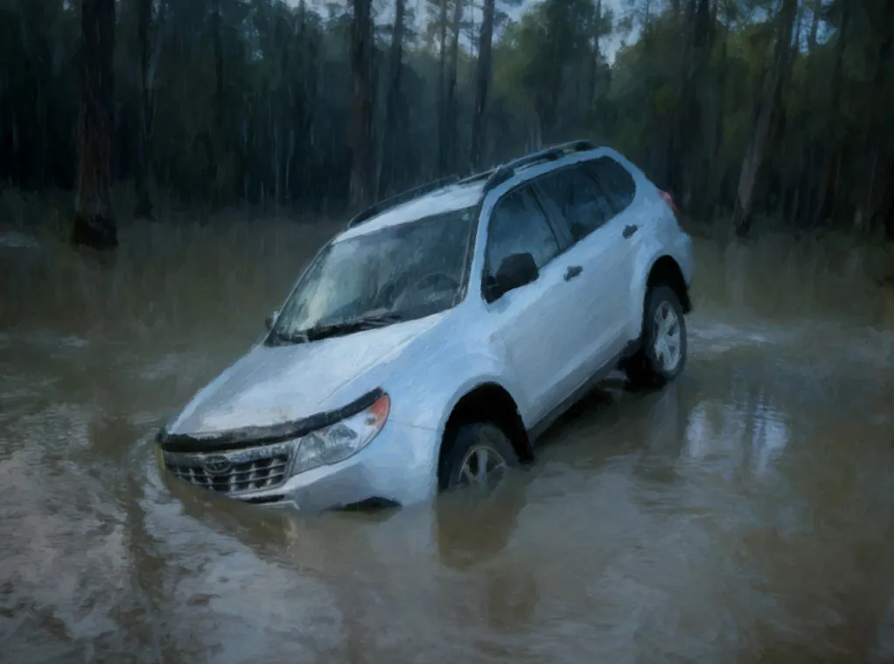

## Как вовлечь сыщиков

Сыщики — молодые люди из жилого комплекса «Сталлион-Кроссинг». Они познакомились на ежегодном барбекю у бассейна в День поминовения. В тот день за выпивкой, музыкой и разговорами они сошлись, словно всегда были знакомы. С тех пор они не разлучались: из такой разной компании получился тесный круг друзей, которых объединяют живые разговоры и посиделки до ночи.

Сыщики собирались переждать ураган вместе, но пришли вести, что буря усиливается и объявлена эвакуация. Они собрались как могли и выехали на машине. Погода всё ухудшалась, пока они не разбились. Сыщики приходят в себя в разбитом внедорожнике, в глазу урагана. У них мало времени, чтобы выбраться, а по меньшей мере один из них ранен.

## Акт I. Из огня да в полымя

> **Скверна Матери**
>
> На протяжении сценария сыщики рискуют заразиться Скверной Магна Матер. Это может произойти, если съесть осквернённую пищу, например чили на кухне, или получить рану от осквернённых крыс. Такому сыщику нужна трудная проверка **ВЫН**. Даже при успехе ему нездоровится: кожа чешется и опухает, живот болит или расстраивается пищеварение. При провале он осквернён Магна Матер. Теперь он более восприимчив к влиянию Шуб-Ниггурат и получает штрафную кость ко всем проверкам **МОЩ**, связанным с сопротивлением её силе. Из любых полученных ран сочится чёрный ихор, который противоестественным образом восстанавливает сыщику `1d4` ПЗ. Наконец, у сыщика могут начаться галлюцинации, время от времени требующие проверки **Рассудка** (`0/1d2`). Бросьте `1d4` или выберите из списка:
>
> 1. **Шёпот.** Сыщик слышит шёпот растений, животных или даже других сыщиков. Голоса убеждают его уйти от остальных, говорят, что ему грозит опасность и что единственное безопасное место — амбар.
> 2. **Видения.** Мир изгибается и коробится. Тени сами вытягиваются и дёргаются, черты лиц друзей искажаются.
> 3. **Зуд.** Сыщик чувствует, как прямо под кожей ползёт что-то, похожее на крохотные ножки или корешки.
> 4. **Голод.** Другие сыщики пахнут аппетитно: жареным мясом, сладкой кровью и тёплым костным мозгом.

### Сцена 1. Последствия аварии

Машина сыщиков разбилась в глухом затопленном лесу. Они приходят в себя в странной, тяжёлой тишине. Машина накренилась вправо. Вокруг всё неестественно неподвижно. Воздух горяч и густ, давит на грудь. Лес искорёжен. Машина и дорога завалены листьями и ветками. Над головой тёмно-синее небо переходит в оранжевое и красное. Вдали громоздятся чёрные грозовые тучи, образуя огромное кольцо. Ни ветра, ни звука — только тихая капель да скрип переломленных деревьев. Сыщики в глазу урагана, и уже темнеет. Успешная проверка **Идеи** (**ИНТ**) подскажет, что затишье продлится от силы пару часов. Надо как можно скорее найти укрытие.

Телефоны не ловят сеть — скорее всего, из-за урагана.

Пусть каждый игрок бросит `3d6×3`, чтобы определить начальную **Удачу**. Сыщик с наименьшей Удачей серьёзно ранен: глубокий порез или перелом (`1d4` урона). Если есть неигровые персонажи (то есть готовые сыщики, которых никто не выбрал), один из них без сознания от сотрясения мозга (`1d6` урона).

Выйдя из машины, сыщики слышат тихое гудение. Успешная проверка **Слуха** позволяет распознать звук генератора. Если посмотреть в ту сторону, вдали виден слабый свет с фермы Торнов.

При сыщиках всё, что указано в разделе «Имущество» на их листах. Успешная проверка **Удачи** позволит достать из машины дополнительные вещи, например хозяйственный нож, аптечку, перцовый баллончик, большой фонарь или верёвку.
