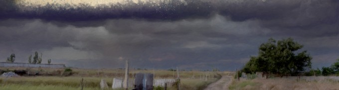

### Сцена 2. Ферма Торнов

Через полчаса пути по затопленному лесу показывается ферма Торнов. Между сыщиками и постройками лежит кукурузное поле. Подъездная дорога затоплена, и до главного дома ещё минут двадцать.

Дом стоит посреди фермы. Он большой и старый, с крутой крышей и большими окнами. Возраст заметен, но дом выглядит ухоженным. Из окон льётся тёплый свет, а позади тихо гудит генератор. Из трубы идёт дым. Остальные постройки разбросаны по ферме.

#### План фермы

**Кукурузное поле.** Сразу за лесом начинается кукуруза. Стебли высоко поднимаются со всех сторон и тихо шелестят, хотя ветра нет. Тропы вьются так, что в них не угадывается никакой логики, под ногами вязкая грязь. Стебли слишком гладкие и толстые, листья блестят в угасающем свете. Из набухших зёрен течёт тёмно-красная жидкость, похожая на загустевшую свёрнувшуюся кровь. Она сладковато и резко пахнет гнилым мясом.

Как только сыщики ступят на землю фермы, Сэмюэл начинает преследовать их на расстоянии. Трудная проверка **Внимания** или **Слуха** даст понять, что в кукурузе есть кто-то ещё. Если сыщики подойдут слишком близко, Сэмюэл исчезнет.

**Сенокос.** За домом Торнов тянется тихий заросший луг. Высокая трава скрывает неровности земли и странные холмики. При осмотре успешная проверка **Внимания** обнаружит под сеном несколько старых машин. Большинство ржавые и сломанные, но зелёный пикап «Шевроле» ещё на ходу. На нём глубокие царапины и тёмные пятна, ключи в бардачке. У сенокоса припаркован эвакуатор Сэмюэла. Там пахнет ржавчиной, маслом и старым сеном. Эвакуатор заперт, ключи в левом кармане комбинезона Сэмюэла.

**Гараж.** Рядом с домом стоит большой гараж без окон. Ворота открыты. Изнутри тянет маслом, плесенью и чем-то медным. В гараже припаркован красный «Камаро»; есть место ещё как минимум для одной машины. *(Примечание хранителя: это «Камаро» Франклина Хенкеля. Ключи могут оказаться в комнате Сэмюэла, в детской или где угодно, если это усилит драму.)*

**Сарай для инструментов.** Приземистая деревянная постройка с покатой крышей. Доски старые, выветренные, но ещё крепкие. Дверь немного заедает, но не заперта. Внутри пахнет землёй, маслом и металлом. Инструменты валяются на полках, верстаках и земляном полу. Орудия с лезвиями висят рядами, землекопные инструменты стоят в углу. Режущий инструмент разложен на длинном верстаке по размеру. Большая часть изношена, но за всем ухаживают. Под верстаком в тени стоят две помятые металлические канистры с надписью «БЕНЗИН», обе полные.

**Кукурузный амбар.** Старый амбар заваливается внутрь, дерево отсырело и гниёт. Внутри огромные початки с набухшими серыми, чёрными и жёлтыми зёрнами. Из многих сочится густой чёрный ихор, пахнущий гнилью и кислым молоком. Проверка **Естествознания** или трудная проверка **Знаний** (**ОБР**) позволяет понять, насколько это необычно. Проверка **Внимания** обнаружит среди шелухи мелкие кости. В кукурузе шныряют крысы-мутанты.

**Амбар.** В дальнем конце фермы стоит большой красный амбар. Главные раздвижные ворота приоткрыты, но скреплены толстыми цепями и огромным навесным замком. Внутри слишком темно, чтобы что-то разглядеть. За амбаром лес словно поглощает красную громадину. Если сыщики сейчас попробуют проникнуть внутрь силой, хранитель может отправить Сэмюэла в атаку. Или сыщики услышат крик из дома: это пленница Пэм, см. **8. Комната Сэмюэла**.

