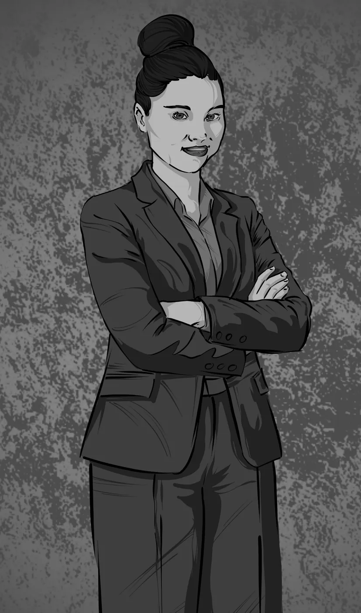

> Тело Сары становится его головой. На коже раскрываются глаза разных цветов и форм и глядят прямо на вас. Из растительного тела вырастает широко разинутая пасть; вместо зубов — сплошные шипы. Чудовище надвигается на вас».

Всем свидетелям превращения нужна проверка **Рассудка** (`1d4/1d10`). Даже если ритуал удалось сорвать, благоразумные сыщики теперь попытаются бежать. Можно воспользоваться «Камаро» в гараже, пикапом на сенокосе или эвакуатором Сэмюэла, если удалось добыть ключи. Можно бежать и пешком, пытаясь оторваться от чудовища или Сэмюэла.

Если же сыщики не обезвредят Салли и не нападут на Сару, призванная через бурю потусторонняя сущность быстро расправится с ними — и с большей частью планеты.

## Развязка

Сыщикам, которые не стали обедом для Шуб-Ниггурат, её аватара или семьи Торн, всё ещё предстоит пережить ураган. К счастью, и после срыва ритуала, и после бегства от его последствий ураган вскоре стихает до неприятного, но вполне переживаемого ливня. Если сыщики уехали на «Камаро» или одной из грузовых машин, радио может вдруг ожить и заиграть ту же мелодию, что звучала у Торнов на проигрывателе.

### Награды

Выжившие сыщики получают `1d6` пунктов **Рассудка**. Возможны дополнительные награды:

- За спасение Пэм: `+1d4` пункта **Рассудка**.
- За обезвреживание Сэмюэла (временное: он ещё вернётся в продолжении): `+1d6` пунктов **Рассудка**.
- Если сыщики сорвали ритуал, обезвредив Салли или напав на Сару, и не дали Магна Матер явиться на Землю: `+1d8` пунктов **Рассудка**.

### Эпилог

По окончании сценария дайте игрокам возможность рассказать, что стало с их сыщиками, и оглянуться на ужасные события той ночи. Пусть подумают, что произошло и как это их изменило.

### Сцена после титров (необязательно)

Хранитель может прочесть или пересказать следующую сцену, если Сара пережила ночь в облике аватара Магна Матер. Вместо Сары можно взять Пэм, Салли или любую из сыщиц, оставшихся на ферме Торнов.

> Агент Нина Салазар едет по гравийной дороге. Шины хрустят по гравию, машина останавливается перед домом. Ни движения. Слишком тихо.
>
> Нина поднимается на крыльцо и стучит один раз. Дверь со скрипом отворяется сама. На пороге женщина. Улыбается. Кожа гладкая. Ни синяков. Ни ран. Ни крови. Она спокойна. Безмятежна. Неподвижна.
>
> — Добрый день, мэм, — говорит Салазар и показывает удостоверение. — Специальный агент Нина Салазар, ФБР. У меня несколько вопросов о ночи, когда налетел ураган «Гуннар».
>
> — Конечно, агент, — тепло улыбается женщина. — Проходите. Проголодались? Я чили приготовила. Может, и пирог ещё остался.
>
> Нина не сразу двигается с места. Чутьё подсказывает: что-то не так. Женщина отступает в сторону, всё так же улыбаясь.
>
> После долгой паузы Нина заходит. Когда обе оказываются в доме, дверь закрывается сама. Вдалеке слышится рокот бензопилы.

