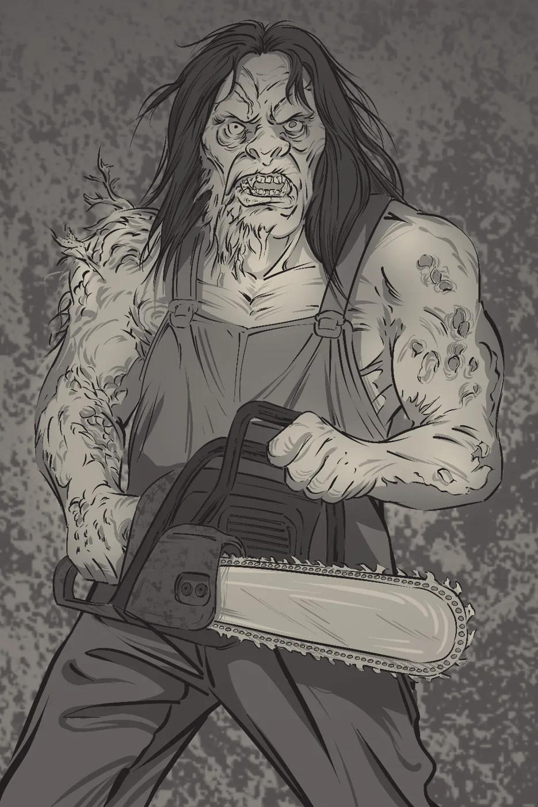

## Персонажи и чудовища


### Салли Торн

*Матриарх Культа Магна Матер.*

```stat
СИЛ 50    ВЫН 60    ТЕЛ 45    ЛВК 60    ИНТ 80
НАР 55    МОЩ 90    ОБР 65    Рассудок 0    ПЗ 10
БкУ: 0    Комплекция: 0    Скорость: 8    ПМ: 18    Удача: неприменимо

Атак за раунд: 1.
Ближний бой (Драка): 50% (25/10), урон 1d4 + БкУ.
Уклонение: 50% (25/10).

Навыки: Обращение с животными 45%, Мифы Ктулху 39%, Красноречие 70%, Первая помощь 50%, История 50%, Работа в библиотеке 50%, Слух 60%, Естествознание 60%, Оккультизм 50%, Психология 50%, Внимание 60%, Скрытность 60%, Шитьё 50%, Мыловарение 50%, Родной язык (английский) 65%, Иностранный язык (латынь) 45%.
Броня: нет.
Заклинания: Внемли Матери (Audi Matrem; как «Околдовать жертву», Книга хранителя, с. 258), Разбить сердце (Cardium Frangere; как «Хватка Ниогты», Книга хранителя, с. 250), Путь теней (Transitio Umbrae; см. с. 147).
```

*Прим. перев.:* расчётная Скорость Салли без возрастной поправки — 9, а не 8. Страницы Книги хранителя указаны по английскому изданию.



### Сэмюэл Торн

*Каратель Культа Магна Матер.*

```stat
СИЛ 95    ВЫН 95    ТЕЛ 90    ЛВК 60    ИНТ 45
НАР 15    МОЩ 70    ОБР 30    Рассудок 0    ПЗ 18
БкУ: +1d6    Комплекция: 2    Скорость: 8    ПМ: 15    Удача: неприменимо

Атак за раунд: 1.
Молоток (Драка): 80% (40/16), урон 1d8 + БкУ.
Нож мясника (Драка): 80% (40/16), урон 1d6 + БкУ.
Бензопила: 80% (40/16), урон 2d8.
Уклонение: 40% (20/8).

Навыки: Обращение с животными 50%, Лазание 50%, Мифы Ктулху 15%, Вождение автомобиля 40%, Электрика 40%, Первая помощь 50%, Запугивание 65%, Прыжки 50%, Слух 50%, Механика 50%, Скрытность 65%, Чтение следов 50%.
Броня: 2 (толстая шкура); восстанавливает 1 ПЗ за час покоя.
Потеря Рассудка: 1d3/1d6 при встрече с Сэмюэлом.
Заклинания: Путь теней (Transitio Umbrae; см. с. 147).
```

*Прим. перев.:* при МОЩ 70 расчётные ПМ — 14, в оригинале — 15.
