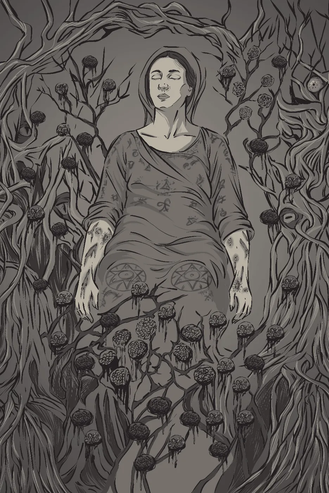

### Сара Торн

*Аватар Магна Матер (чудовищный облик).*

```stat
СИЛ 140    ВЫН 120    ТЕЛ 110    ЛВК 60    ИНТ 75
НАР 5      МОЩ 120    ОБР 70     Рассудок 0    ПЗ 50
БкУ: +2d6    Комплекция: 3    Скорость: 8    ПМ: 100    Удача: неприменимо

Атак за раунд: 2.
Ближний бой (Драка): 85% (42/17), урон 1d3+2d6.
Захват: 85% (42/17), урон 1d6 в первом раунде и ещё 1d6 в каждом последующем, пока аватар пожирает жертву.
Уклонение: 50% (25/10).

Навыки: Прыжки 60%, Слух 60%, Внимание 60%.
Броня: 4; восстанавливает ПЗ, «съеденные» у схваченных сыщиков.
Потеря Рассудка: 1d4/1d10 при встрече с аватаром.
Заклинания: любые, какие хранитель сочтёт уместными.
```

*Прим. перев.:* расчётные БкУ, Комплекция, ПЗ и ПМ — +4d6, 5, 23 и 24. У аватара сохранены особые значения из оригинала.

### Стая осквернённых крыс

Эти грызуны встречаются по всей ферме. Вздувшиеся тела, лысые проплешины, лишние конечности, слепые красные глаза и раздвоенные челюсти. На спинах пульсируют опухоли. Их писк пугающе похож на плач младенцев.

```stat
СИЛ 40    ВЫН 60    ТЕЛ 35    ЛВК 75    МОЩ 45    ПЗ 9
БкУ: −1    Комплекция: −1    Скорость: 9    ПМ: 4

Атак за раунд: 1 (при любой атаке жертва может подвергнуться Скверне; см. «Скверна Матери»).
Ближний бой (зубы и когти): 50% (25/10), урон 1d3-1.
Задавить (манёвр): 50% (25/10), урон 2d6-1. Крысы могут всей стаей наброситься на одну жертву и задавить числом по правилам манёвров, кусая и царапая на ходу. Из-за численного превосходства они получают одну бонусную кость к атаке.
Уклонение: 45% (22/9).
Броня: нет.
```

*Прим. перев.:* при МОЩ 45 расчётные ПМ — 9, а не 4.

## Новые заклинания

### Путь теней (Transitio Umbrae)

*Дар Шуб-Ниггурат.*

**Время сотворения:** мгновенно.  
**Цена:** 5 пунктов магии, `1d3` пункта **Рассудка**.

Заклинание позволяет шагнуть в одну тень и выйти из другой, пройдя сквозь складки тьмы. Обе тени должны лежать на земле, посвящённой Шуб-Ниггурат. Это не телепортация в обычном смысле, а путь через измерение извивающегося, плодовитого мрака.

Этот запретный обряд дети Чёрной Козы передают шёпотом под безлунным небом. Освоившие заклинание носят на теле знаки преданности Магна Матер. Говорят, это дар самой Шуб-Ниггурат, который она ниспосылает во сне или в видениях.

Творящий заклинание должен произнести обращение к Магна Матер на осквернённой земле и пройти проверку **МОЩ** (встречную, если есть какое-либо сопротивление).

При успехе заклинатель исчезает в одной тени и мгновенно появляется из другой не далее чем в 100 м. И вход, и выход должны быть именно падающими тенями — естественными или искусственными. В раунде перехода заклинатель не может действовать.

При провале заклинатель застревает в мире теней на `1d4` раунда. Он не может действовать, и никто не может его воспринять.

При крахе заклинатель выходит не там, где намеревался (место определяет хранитель), и теряет `1d6` пунктов **Рассудка** от пребывания во владениях Чёрной Козы.
