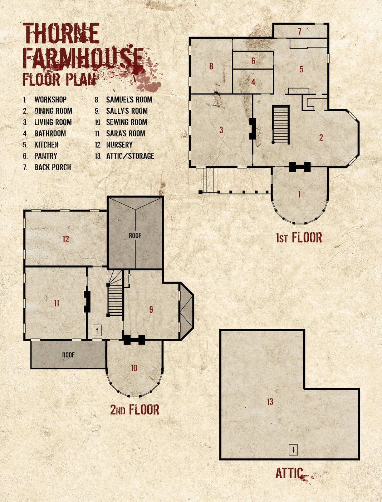

> **Раздатка 2. План дома Торнов**
>
> План дома Торнов
>
> 1. Мастерская
> 2. Столовая
> 3. Гостиная
> 4. Ванная
> 5. Кухня
> 6. Кладовая
> 7. Заднее крыльцо
> 8. Комната Сэмюэла
> 9. Комната Салли
> 10. Швейная
> 11. Комната Сары
> 12. Детская
> 13. Чердак/кладовка.
>
> Первый этаж; второй этаж (крыша); чердак.

*Прим. перев.:* на плане в позиции 11 напечатано `Sara’s Room`, тогда как в сценарии имя Сары пишется `Sarah`.
