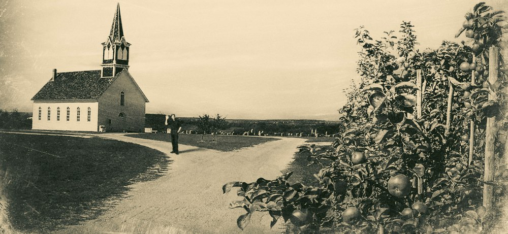

# Служить на небесах

Сценарий «Зова Ктулху» эпохи Пыльного котла. Автор: Маверик Хенце (Maverick Haenze).

**Сыщики:** 2–4 • **Время игры:** 4 часа

## Вступление

Когда у вас нет ничего, чем вы готовы пожертвовать ради шанса получить всё? В 1934 году горстка отчаявшихся, голодных сыщиков натыкается на маленький процветающий городок в самом сердце техасского Пыльного котла. Горожане встречают их с распростёртыми объятиями, кормят, одевают и дают работу. Это рай посреди мира лишений, утрат и отчаяния. Увы, за такую жизнь приходится платить.

Сценарий ставит сыщиков перед трудным выбором. Культ бомбардирует их любовью: даёт им то, в чём они нуждаются больше всего, обещает покой и безопасность, но требует пожертвовать частью себя и вместе с остальными почитать Мать. Что для сыщиков важнее: спокойная, обеспеченная жизнь или возможность остаться собой?

### Структура сценария

В начале сценария измученные сыщики бредут по грунтовой дороге на Техасском выступе в поисках работы. Хранителю стоит расспросить игроков о том, как их персонажи прожили последние несколько месяцев.

В **Акте I** сыщики натыкаются на Либерти-Корнерс — цветущий оазис в море пыли. Горожане радушно принимают их, дают поесть и предлагают отдохнуть с дороги под крышей. Устроившись на новом месте, сыщики идут на общую трапезу, которую возглавляет местный священник, пастор Сайлас Клегг.

**Акт II** начинается на следующий день: сыщики приходят в себя после страшных кошмаров. Они берутся за порученную работу и постепенно узнают больше о городе, его истории, жителях и тайне здешнего изобилия.

В **Акте III** сыщики идут на службу в Церковь Владычицы Зеленеющей Земли и участвуют в Благословении урожая. Начинается всё безобидно, с гимнов «нашей Матери», но затем пастор Клегг разражается пламенной проповедью. Под конец несколько горожан приносят жертвы ради урожая — кровь и части тела, смешанные со странной чёрной слизью, — а пастор читает заклинание из книги. Затем сыщикам предлагают выбор: принести жертву и навсегда стать своими в городе или бежать без оглядки… и навлечь на себя страшные последствия.
