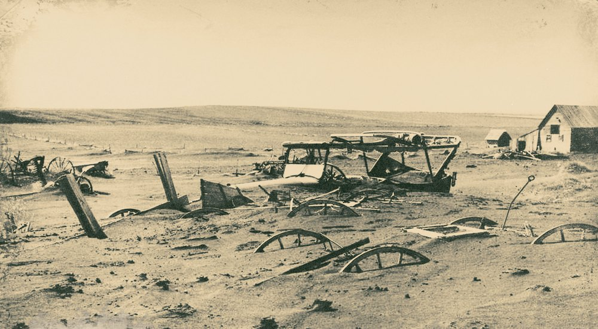

## Предыстория

В 1930 году началась засуха, которая обрекла целый край на бедствие, позже получившее название Пыльного котла. Либерти-Корнерс и прежде едва сводил концы с концами, а теперь пострадал не меньше, чем весь Средний Запад США. В 1932 году в городе появился Сайлас Клегг, человек на редкость живой и деятельный. Он уверял, что священной силой божества, которое звал Матерью, сумеет отогнать пыль и вернуть Либерти-Корнерс зелень и жизнь. Он выдохнул в воздух семена, и они пустили корни. Через несколько месяцев окрестные фермы ожили. Увидев это чудо, горожане стали почитать Мать и делиться её дарами со всеми приезжими. Их принимали, любили и кормили, кем бы они ни были и что бы ни натворили. При одном условии: каждый должен был пожертвовать частицей себя.

Сыщики приходят в Либерти-Корнерс в сентябре 1934 года, как раз к началу очередного богатого урожая. Они — дети своего времени: Великая депрессия отняла у них всё — близких, дом, работу, уважение. Им отчаянно хочется поесть, найти работу и снова почувствовать себя людьми. У каждого есть заветная потребность, которую способен удовлетворить этот город. В этом и заключается главный конфликт сценария.

### Пыльный котёл

Пыльный котёл потряс страну, ещё не оправившуюся от краха Уолл-стрит в 1929 году. Многие, особенно те, кто обрабатывал землю, лишились всех средств к существованию, а то и большего. Пыльные бури и экологическая катастрофа принесли засуху и болезни: одних они убили, других довели до отчаяния. Целые семьи снимались с места в поисках работы. Те, кто не мог уехать, перебивались случайными заработками за еду и крышу над головой. Для простого работяги, как и для сыщиков, мир суров и беспросветен: не знаешь, где поешь в следующий раз и где приклонишь голову. Хранителю стоит дать игрокам почувствовать, как тяжело и безрадостно жилось их персонажам до сих пор и как отчаянно их положение сейчас.

### Хронология

- **1930–1932:** Волны пыльных бурь обрушиваются на Средний Запад и юго-запад США. Сыщики, как и многие другие, остаются без средств к существованию. Либерти-Корнерс — один из бесчисленных разорённых городков.
- **Апрель 1932:** Пастор Сайлас Клегг прибывает в Либерти-Корнерс. Он возвращает земле плодородие дарами Матери и обращает жителей в её веру. *Прим. перев.:* в хронологии оригинала — Саймон Клегг; в остальном тексте его зовут Сайласом.
- **1934:** Общая беда сводит сыщиков вместе, и они отправляются в путь одной компанией.
- **9 сентября 1934:** Сыщики прибывают в Либерти-Корнерс.
