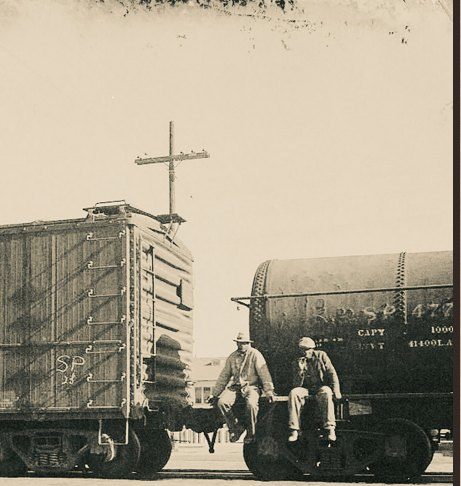

### Лиззи Райт, 32 года
*Жизнерадостная школьная учительница*

Весёлая, лучистая женщина с непослушными тёмными волосами и любопытными глазами. В свободное от уроков время носит удобное платье с передником. Одежда явно не новая, но умело заштопана и прекрасно сохранилась. Лиззи приехала в Либерти-Корнерс почти два года назад и нашла здесь всё, о чём могла мечтать. У неё нет левого уха, хотя за длинными распущенными волосами этого почти не видать.

**Черты:** Общительна, брызжет энергией; дай ей волю — заговорит кого угодно. Заботливая и ласковая, всей душой любит мужа, маленькую дочку и родной город.

**Подсказки для отыгрыша:** Лиззи считает своей обязанностью встречать приезжих и с удовольствием покажет сыщикам город.

### Билли Лазарус, 45 лет
*Трудолюбивый фермер*

Высокий крепыш с обветренным лицом и тяжёлой челюстью. Носит потёртый комбинезон и выцветшую рубаху, запачканную за долгий рабочий день. Ферма принадлежит его семье больше века, и даже когда пришли пыльные бури, он наотрез отказался уезжать. У него нет большей части зубов.

**Черты:** Суров, не любит пустых разговоров. Выше всего ценит честность и трудолюбие, уважает всякого, кто старается изо всех сил. Страшно гордится фермой и тем, чего ему удалось добиться благодаря благословениям Матери.

**Подсказки для отыгрыша:** Билли даст работу любому желающему и будет трудиться с ним бок о бок. О Матери и её дарах говорит с тихим благоговением, а сыщиков зовёт убедиться в её щедрости своими глазами.

### Сьюзан Эллиотт, 51 год
*Городская сплетница*

Высокая, нескладная женщина с маленькими цепкими глазами за круглыми очками. Её наряды были модными лет десять назад, но она бережёт их. Всю жизнь прожила в Либерти-Корнерс. Когда пришли пыльные бури, её муж умер, но Сьюзан решила остаться и принять дары Матери. У неё нет левой кисти.

**Черты:** Любопытна до назойливости, хочет знать обо всех всё, и приехавшие сыщики — не исключение. Ей искренне интересно, что ей рассказывают, а в ответ она охотно делится сведениями о городе и его жителях. Любит Либерти-Корнерс и всех, кто здесь живёт, и не понимает, зачем вообще отсюда уезжать.

**Подсказки для отыгрыша:** Сьюзан может предложить сыщикам свободную комнату. Она очень разговорчива и не упускает случая что-нибудь выведать.

## Как вовлечь сыщиков

Сыщики — странствующие рабочие, которые разъезжают по юго-западу США в разгар Пыльного котла и Великой депрессии. В поисках работы они идут через равнину к ближайшей железнодорожной ветке и по дороге попадают в Либерти-Корнерс.

Пусть игроки представятся и опишут своих персонажей. Хранитель спрашивает, давно ли они путешествуют вместе, а затем задаёт каждому по одному вопросу из списка:

1. Кому из других сыщиков вы больше всего сочувствуете и почему?
2. Кто из других сыщиков вам ближе всего и почему?
3. Какую тайну вы доверили только одному из других сыщиков? Кому именно?
4. Кто из других сыщиков выручил вас из беды и как это было?
